<div align="center">


<br><br>

<a href="https://github.com/IshaanNene/DebugAssist/actions/workflows/ci.yml"></a>       <a href="LICENSE"></a>

<h3>An autonomous on-call engineer for a ride-hailing app.<br>Crash or bug report in → triage, root cause, mitigation, a failing test, the fix, proof, and a pull request out.</h3>

<b><a href="https://ishaannene.github.io/DebugAssist/">🌐 Website</a> · <a href="#-results">Results</a> · <a href="#-see-it-work">Demo</a> · <a href="#-how-it-works">How it works</a> · <a href="#%EF%B8%8F-dashboard">Dashboard</a> · <a href="#-mcp-servers">MCP servers</a> · <a href="#-a-real-bug-end-to-end">A real bug</a> · <a href="#-the-bug-catalog">Bug catalog</a> · <a href="#-quickstart">Quickstart</a> · <a href="#%EF%B8%8F-guardrails">Guardrails</a></b>

</div>

<br>

<table>
<tr>
<td width="33%" valign="top">
<h3>🟧 Clef decides</h3>
Every judgement call — priority, root-cause category, roll back a flag or not, which test tier, retry, ship as PR or draft — is one of <b>18 Cloudflare Clef decision templates</b> returning probabilities, mapped to <i>act / escalate / safe default</i> by policy and written to a ledger. Does Clef beat an LLM making the same calls? <a href="#does-clef-help-not-yet">Not yet, by our own numbers</a>.
</td>
<td width="33%" valign="top">
<h3>🟪 LLMs reason</h3>
Agents read the crash, query <b>11 MCP servers</b> (crash analytics, logs, traces, metrics, flags, git history, code search, releases, incidents, bug reports, Jira) and write a root cause in which every claim cites an evidence id. Then they write a failing test and the smallest fix.
</td>
<td width="33%" valign="top">
<h3>🟩 Code acts</h3>
The plan is a fixed <b>LangGraph</b> graph; models never choose the next step. Agents work in a <b>network-less Docker sandbox</b> on a git worktree, and every write — PR, ticket, flag rollback — passes a policy gate and lands in an audit log.
</td>
</tr>
</table>

## 🚀 Quickstart

**Anyone — no Docker, no keys, a few minutes.** Clone, run every test, and regenerate the evaluation report from the committed runs: the numbers [below](#-results) come out identical (checked on an anonymous clone).

```bash
git clone --recurse-submodules https://github.com/IshaanNene/DebugAssist && cd DebugAssist
make bootstrap                                      # uv workspace (Python 3.13) + git hooks
make doctor                                         # what this machine has: Docker, submodules, keys (names only)
make check                                          # ruff + pyright strict + every test (what CI runs)
uv run debugassist eval report --notes evals/notes/2026-10-11.md   # rebuild the report from evals/runs/
```

<sub>The clone checks out the public client repo and skips the private services repo (<code>miniride-services</code>) instead of failing. The per-run evidence lives in <code>evals/runs/</code> and the labelled decisions in <code>evals/ledger/decisions.jsonl</code>, so the report needs neither the stack nor the local ledger database.</sub>

**The live stack and the demo — needs access to `miniride-services`.** The gateway, dispatch and payments services are built from it, so the stack, the scenarios and the keyless demo run only with access (`make targets` fetches it when you have it), Docker, and about 10 GB of RAM:

```bash
make targets                                        # fetch the target repos you can access
make up PROFILES="core obs flags faults target sources" && make flags
make demo-push-crash                                # keyless: scripted LLM, mock Clef/GitHub/Jira/chat
make dashboard                                      # http://localhost:3000
```

To go live, add keys to `.env` (see [`.env.example`](.env.example)); each integration switches to live when its credentials are present (GitHub only when its token is in `.env`, not merely exported), or force one with `DA_MODE_<LLM|CLEF|GITHUB|GITHUB_APP|JIRA|CHAT>=live|mock`:

```bash
uv run debugassist run latest --llm live            # real agents, Clef, GitHub PR and Jira ticket
make trigger BUG=009 && uv run debugassist run latest --llm live
uv run debugassist app poll                         # GitHub App: labeled issues on installed repos (docs/github-app.md)
```

<details>
<summary><b>More commands</b></summary>
<br>

| Command | |
|---|---|
| `make scenarios` / `make trigger BUG=002` / `make reset-scenario` | list the catalog / inject a bug and drive riders into it / back to main |
| `debugassist eval estimate\|run\|replay\|report` | price, run, replay and report an evaluation (refuses runs over `--max-usd`) |
| `make traffic` / `make load` | normal rider traffic (Playwright) / backend load (Locust) |
| `make check` / `make coverage` | ruff + pyright strict + pytest / the same tests with CI's coverage floors |
| `debugassist audit` / `debugassist prune` / `debugassist eval latency` | what was written outside the sandbox / free old runs' worktrees / where a run's time goes |
| `make lint-skills` / `make pex AGENT_TYPE=…` / `make worker` | marketplace lint / package an agent type / queue worker |
| `make readme-assets` / `make screenshots` | rebuild README visuals from the latest report / proof screenshots of the stack |
| `uv run debugassist decide …` | ask Clef a single decision from a template (D01–D18) |
</details>

## 📊 Results

<div align="center">
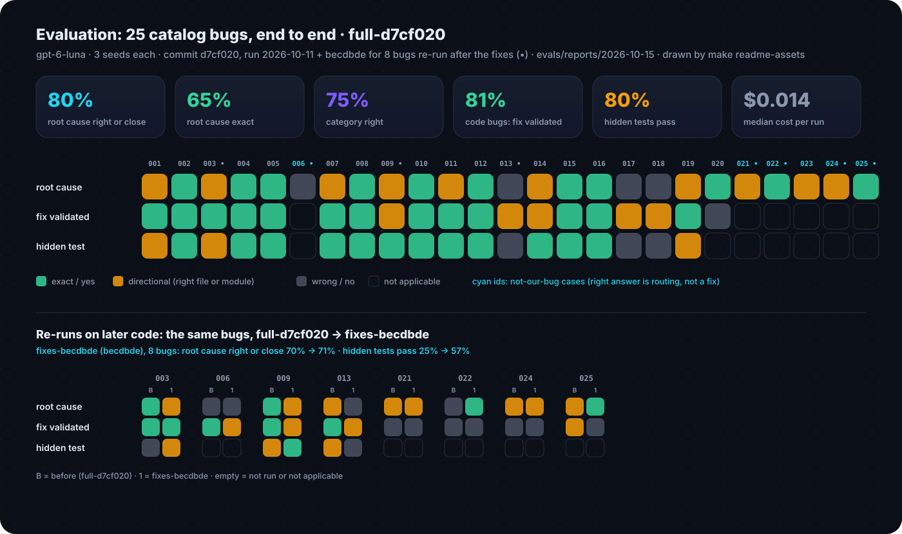
</div>

Every catalog bug was injected into the MiniRide repos, discovered from simulated rider traffic, and run through the whole pipeline with no human in the loop. The agent never sees the answer key; an evaluator scores its root cause against the catalog and runs **hidden tests** on its fix. The card above is drawn from [`evals/reports/2026-10-15`](evals/reports/2026-10-15/report.md) by `make readme-assets`; nothing in it is typed by hand. The top grid shows every catalog bug's latest **three-seed** run: all 25 on commit `d7cf020` (`make eval-full`), with the 8 bugs re-run after the last round of fixes (marked •) on `becdbde`; amber means the seeds disagreed or the root cause was only close, grey means a miss. Against the first one-seed run on the code of 2026-10-07, root cause right or close went from 64% to **80%**, exact from 48% to **65%**, and hidden tests passing from 47% to **80%**, at a median of **$0.014** a run. The panel below compares the re-run bugs before and after those fixes.

<table>
<tr>
<td width="50%" valign="top">

**What works**
- **Crash-data bugs in one repo** — locale and currency edge cases, a nil-map panic, a removed `await`, a background poller draining battery: ten code bugs pass every lane (root cause, validated fix, hidden test) in all three seeds.
- **Following a rider's report into the backend** — with the cross-repo hand-off, a rider's in-app report leads the investigation into the service that holds the defect, and the fix moves there: the cross-city matching bug now passes every lane in all three seeds and a payments tariff typo is fixed in all three (hidden test in two); none of the six report-only services bugs had the right root cause before.
- **Fix quality after reading failed runs** — three harness fixes (a Python sandbox that lost its interpreter, an evaluator that never allowed a retry, an edit tool that rejected near-misses) took hidden-test passes on the eight re-run bugs from 0 to 5; across the catalog, 74% of hidden tests now pass.
- **Saying "not our bug"** — a carrier outage and an ETA complaint about intended behaviour were routed, not "fixed".
- **Routing what isn't ours** — after routing on the root cause's own category, a single-device WebView crash, a vendored-SDK hang and a flag misconfiguration went from misses (or code fixes that shouldn't exist) to exact in most seeds, at about a cent a run instead of five to ten.
- **Cost** — a median of $0.014 per end-to-end run on `openai/gpt-6-luna`; the whole three-seed sweep cost under $2.

</td>
<td width="50%" valign="top">

**What doesn't (yet)**
- **Stopping where the symptom surfaced** — a CORS change and a payments panic were blamed on the client's gateway address and on the gateway's timeout, in every seed: the investigation doesn't yet follow a failed call to the service it called.
- **Fixes narrower than the regression** — some fixes pass the agent's own test but not the hidden one: a fix restored the retry key but kept the shortened timeout from the same commit; another added the one missing city instead of handling a missing city. Prompt rules and a second agent's independent test didn't change this; a no-model check that re-spells the reported call rejects every narrow fix in a replay, not yet proven live ([below](#widening-narrow-fixes-four-attempts)).
- **An active incident still loses to suspicious code** — the database incident was in the evidence and a subagent named it, yet every seed blamed client code; and one gateway bug got worse after the last prompt round.
- **Seeds still disagree** on ten bugs, so one run of a bug proves little; one root cause was exact in every seed yet escalated to a human each time, because the agent left the mechanism "unconfirmed" without reading the code.
- **Diminishing returns** — the last round of prompt rules helped some bugs and cost others (a carrier outage moved from `network` to `infra`), so tuning stopped there; the report lists each before → after.
- **Trimming context** — three measured attempts, none switched on: capping file reads (`DA_CONTEXT=lean`) made agents read more often and *raised* input per run; clearing old tool results in batches (`clear`) cut input per turn by about a sixth but lowered the cache hit rate, so cost barely moved; compacting old steps into notes (`compact`, three bugs before the API credit ran out) saved nothing per turn. The report's *Context by arm* table has the numbers.

</td>
</tr>
</table>

### Does Clef help? Not yet

The design bets that small calibrated decision models beat an LLM making the same judgement calls. **Our own measurements don't show that yet.** Replaying every logged decision against the catalog's answers (`debugassist eval replay`, same inputs for each decider):

| Decision | n | Clef | Clef-flash | LLM decider | Rules |
|---|---:|---:|---:|---:|---:|
| D01 triage (priority, owner) | 40 | 0.15 | 0.15 | 0.28 | **0.30** |
| D05 root-cause category | 40 | 0.70 | **0.75** | 0.73 | 0.63 |
| D11 flag rollback | 4 | 0.75 | 0.75 | 0.75 | — |
| D12 localisation | 21 | 0.48 | 0.48 | 0.48 | — |
| D14 test tier | 26 | 0.42 | 0.50 | 0.46 | **0.73** |

<sub>Accuracy against the catalog's answers. Clef's calibration (Brier score) is slightly better than the LLM's on D05, D11 and D14 and worse on D01 and D12; latency and cost per decision are about the same. Rules win on triage and test tier — those templates need rework.</sub>

**End to end, the difference is small and within noise.** We ran the same pipeline with the LLM making every Clef decision (`no-clef` arm, one run per bug, all 24 discovered bugs) and compared it with each bug's latest Clef runs: root cause right or close **0.79 with Clef vs 0.75 without**, exact 0.64 vs 0.58, code-bug fixes validated 0.80 vs 0.78, hidden tests passing 0.67 vs 0.61, at the same cost. The gaps come from a handful of single bugs and go both ways — Clef's fix-strategy decision escalated one bug to a human in every seed where the LLM decider let it be fixed, while two not-our-bug cases were right with Clef and wrong without — and one run against three cannot separate a few points from noise. So on this catalog the outcome is decided by the investigation, not by the decision layer — the case for Clef here is auditability (a ledger of every call, act/escalate bands), not accuracy, until a reworked template shows otherwise.

<sub>25 synthetic bugs, three seeds each in the top grid — read it as strengths and gaps, not precise rates. The report also has a decision-level evaluation (accuracy, Brier, calibration per decision), a replay of the logged decisions across Clef, Clef-flash, an LLM decider and a rules baseline, and every caveat. All runs use `openai/gpt-6-luna`. Reproduce: <code>debugassist eval run --bugs all</code> · <code>debugassist eval replay</code> · <code>debugassist eval report</code>.</sub>

### Real open-source bugs

Beyond the synthetic catalog: five public issues from four small Python libraries, filed and fixed upstream between September and October 2026. Each ran on the code it was filed against, with git history cut at that commit so the upstream fix cannot be found, and was scored against the fix's location and the fix's own regression test. Where a report named its own cause or fix, that part was withheld; every case file lists what ([`sources/github/issues/`](sources/github/issues/)). Three runs each, with the LLM decider:

| Issue | Root cause exact | Fix validated | Upstream's test passes |
|---|---:|---:|---:|
| [tkem/cachetools#435](https://github.com/tkem/cachetools/issues/435) — a `cachedmethod` called through its class raises `AttributeError` | 3/3 | 3/3 | 0/3 |
| [tkem/cachetools#440](https://github.com/tkem/cachetools/issues/440) — a failed TTL insertion leaves an unusable entry | 3/3 | 3/3 | 3/3 |
| [python-semver#484](https://github.com/python-semver/python-semver/issues/484) — an `rc3` prerelease bumps back to `rc.1` | 3/3 | 2/3 | 2/3 |
| [parse#249](https://github.com/r1chardj0n3s/parse/issues/249) — `{:F}` rejects negative numbers; `f`/`F` reject `nan`/`inf` | 3/3 | 3/3 | 3/3 |
| [more-itertools#1304](https://github.com/more-itertools/more-itertools/issues/1304) — `ichunked(…, 0)` raises instead of yielding nothing | 3/3 | 3/3 | 3/3 |
| **All five** | **15/15** | **14/15** | **11/15** |

<sub>Median cost $0.014–0.025 per run. Root cause exact means the file and function upstream changed. The semver hidden test is adapted from upstream's: the issue accepts `rc4` or `rc.4`, so the old-style cases accept either. One semver run was escalated to a human by the fix-strategy decision (a change to version-numbering behaviour) and made no fix. Every cachetools#435 fix made the reported call work but broke keyword access to the instance and `__wrapped__`, which upstream's test also checks.</sub>

#### Widening narrow fixes: four attempts

The misses on real code were fixes as narrow as the report. Asking a model for wider fixes or wider tests did not change that; a check with no model did, in a replay of every fix made so far — not yet proven in a live run with all its parts.

| Attempt | Model | What it did to narrow fixes | Upstream / hidden test |
|---|:---:|---|---:|
| Prompt rules for wider tests and fixes | yes | nothing — reverted | 0/3 on cachetools#435 |
| A second agent's test, written from the report alone | yes | passed 7 of 7 fixes it checked | 1/7 |
| … also shown the repo's other uses (docs, stubs, tests) | yes | sent back 3; every shipped fix still narrow | 0/5 |
| Call variations and class/instance introspection | no | live: sent back 4, two runs no longer "validated"; replay: rejects 14/14, no false alarm in 20 good fixes | 0/3 live |

<sub>All four are off by default; runs `fixwidth-7f15556`, `repro2-f277379`, `callers-0ed427d`, `variants-4b1325c`, and the replay `debugassist eval replay-variants`, in the latest report. The live run of the last check predates its introspection part, which was added after reading upstream's test. Details:</sub>

**Widening fixes by prompt didn't work.** We added two generic rules — the reproduction also guards the ordinary uses a fix must not break (the same call with keyword arguments, sibling inputs, the unit's signature and attributes), and the fix keeps the unit's contract — and re-ran all five real bugs and two catalog bugs. cachetools#435 still failed upstream's test in every run that made a fix (0/3), the same two ways; across the five cases upstream's test passed 9/12 runs that made a fix, against 11/14 before. The rule's keyword-argument example was written with that bug in mind, so even a pass would have proved little. The change was reverted; the runs are in the report as `fixwidth-7f15556`, outside every number above.

**Nor did a second, independent reproduction.** With `DA_SECOND_REPRO=1`, a separate agent writes its own failing test from the report alone — without seeing the fix or the first test — and the fix must pass it too. On the bugs with narrow fixes it passed every fix it checked (7/7), and the hidden tests still failed on six of them (cachetools#435 0/3, BUG-003 0/3, BUG-009 1/1). Both agents read the same report, and the report shows one example: the uses upstream's test also checks are not in it. The switch is off by default; the runs are `repro2-f277379` in the report.

**Showing that checker how the code is used elsewhere made it stricter, not enough.** In callers mode (`DA_SECOND_REPRO=callers`) it also gets the code's other uses — docs, type stubs, tests, callers, collected by git grep. On cachetools#435 it sent back three fixes that had passed their own test, but every fix that shipped still failed upstream's test (0/3), the same two ways; BUG-003 0/2. Nothing in the repository calls the method with `self=` — only upstream's new test does — so no source inside the repo could have told the checker to try it. Runs: `callers-0ed427d`.

**Re-spelling the report's calls mechanically stopped narrow fixes shipping as validated — but not the miss.** With no model at all (`DA_CALL_VARIANTS=1`), the report's Python calls are rewritten the other ways a caller can make them — `Example.value(self=example, number=3)`, `example.value(number=3)` — and with the fix every spelling must behave like the reported one. Replayed on every earlier fix of the five real bugs (`debugassist eval replay-variants`; library calls such as `ichunked(rows, 0)` or `parse.parse("{:F}", "-2.5")` are spelled too, from their run-time signatures), and comparing class and instance access on `__wrapped__`, `__name__` and `__doc__` as plain methods do, it rejects all 14 fixes upstream's test fails, passes all 20 it passes, and passes upstream's own fix on all five. (The attribute comparison was added after reading what upstream's cachetools#435 test asserts, and only that report defines methods, so its no-false-alarm evidence is one upstream fix; no live run with it yet.) Live, three runs: it sent back 4 fixes; only one run still validated, and that fix handles keyword calls — upstream's test went from 10 failing cases to 5, failing on what spellings cannot test (`__wrapped__`, cache statistics). Upstream's test: still 0/3. Runs: `variants-4b1325c`.

### Proving the culprit commit

An RCA names the commit that introduced the bug by reading diffs. With `DA_BISECT=1` the pipeline also *runs* it: once a fix is validated, its reproduction test goes back through history — earlier release tags until it passes, then `git bisect` — with no model. A commit counts as bad only when the test fails the way it does on the release (an import error on old code is skipped, not blamed), and when the whole test file fails on every earlier release, as an agent's test that also asserts the fix often does, each failing case is bisected on its own. Replayed on every earlier validated real-bug run (`debugassist eval replay-bisect`, 30 tests):

| Issue | Result | |
|---|---|---|
| [python-semver#484](https://github.com/python-semver/python-semver/issues/484) | **bisected to `d8813b6`** — "Improve bump_prerelease to always get a newer version (#462)", the change the report blames; last good 3.0.4, 4 steps, 3/3 runs | the RCA named a later commit to the same function each time (#472) |
| cachetools#435 | no good release in this history | broken differently on every 7.x release; its last good release (6.2.0) is on another branch |
| cachetools#440, parse#249, more-itertools#1304 | no good release | the test fails on every earlier release tried |

<sub>Off by default; the PR body gets a "Bisected:" line when it finds one. The catalog is not replayed: each injected release is its last good one plus a single commit.</sub>

### On your own repositories: the GitHub App

Install the app on a repository, add a `.DebugAssist/pipeline.yaml` saying how to build and test it, and label an
issue `debugassist`: the pipeline checks out the default branch, investigates, comments the root cause on the issue
and, when a fix validates, opens a **draft** PR from a `debugassist/*` branch. `debugassist app poll` picks up
labeled issues (no public URL needed); `/github/webhook` on the API queues them as they are labeled. Setup,
permissions and the safety rules: [docs/github-app.md](docs/github-app.md). Built and tested against a fake GitHub
API and the mock; no live app yet.

## ⚠️ Limitations

Read the numbers above with these in mind:
- **Synthetic bugs, one app.** All 25 catalog bugs were written and injected by the author into MiniRide, a small app built for this project. "80% root cause right" is 80% on bugs designed here, not on real-world crashes. Five [real open-source bugs](#real-open-source-bugs) have been run so far — small Python libraries, three runs each; that is a sample, not a benchmark.
- **Same author, both sides.** The catalog and the agent skills were written by the same person. Skills are generic and linted for leaks, and the answer key (`groundtruth/`) never reaches the agent, but it is in this public repo, so a model trained on it later could be contaminated.
- **Small samples.** Three seeds per bug, 25 bugs. Seeds still disagree on ten bugs; treat single-bug differences between arms as noise unless they repeat.
- **Clef is unproven.** See [Does Clef help?](#does-clef-help-not-yet): no accuracy gain over an LLM decider so far.
- **The live stack is hard to reproduce elsewhere.** `miniride-services` is a private submodule, the Clef token is IP-restricted, and the stack needs Docker with about 10 GB of RAM. A plain clone runs every test and regenerates the full evaluation report from the committed runs ([Quickstart](#-quickstart)), but not new live runs.
- **Parked pieces.** Four context-engineering switches (`DA_CONTEXT=lean|clear|compact|concise`) were built and measured or estimated, saved little or nothing, and are off by default; the Discord notifier was never run against a real webhook; the two model-based fix-width checks (`DA_SECOND_REPRO`) did not widen fixes, and the no-model one (`DA_CALL_VARIANTS`) waits for a live run with all its parts. They are listed, with why, under [Parked](docs/ROADMAP.md#parked-2026-10-14) in the roadmap; none is a next step.

## 🎬 See it work

<div align="center">
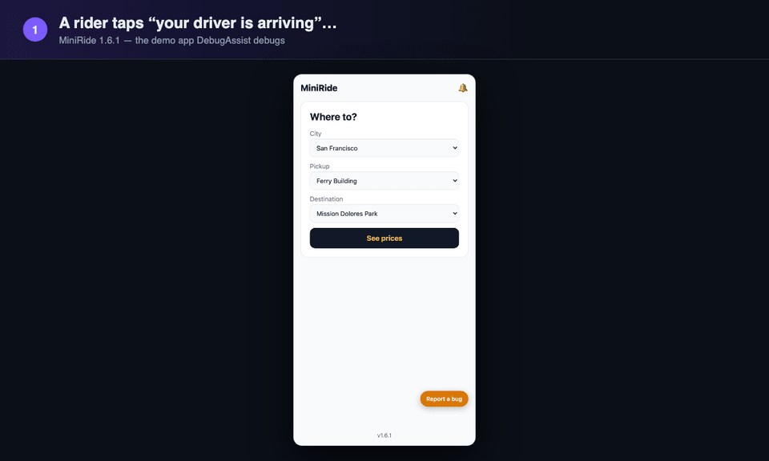
<br>
<sub>Real screenshots of the local stack, then a replay of the keyless demo run (<code>make demo-push-crash</code>: scripted LLM output, mock Clef/GitHub/Jira).</sub>
</div>

## 🧭 How it works

<div align="center">
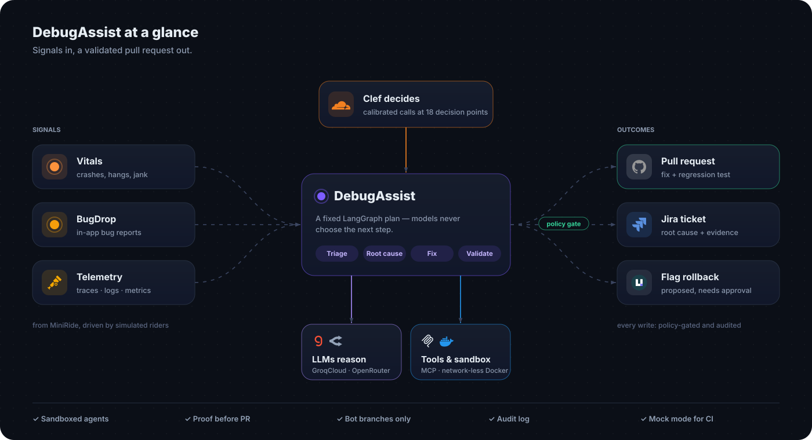
<br><br>
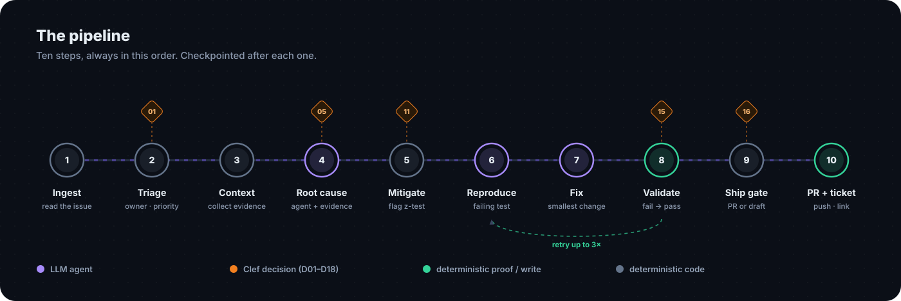
</div>

<details>
<summary><b>The pipeline, step by step</b></summary>
<br>

| Step | What happens | Decision |
|---|---|---|
| **Ingest** | Pull the issue from Vitals (crash analytics) or BugDrop (in-app reports): symbolicated stack, breadcrumbs, versions, flag exposure. The agent type (web crash, backend error, perf regression, user bug report) is resolved here. | |
| **Triage** | Owner from `CODEOWNERS`, priority and severity, dedup against open issues, a Jira ticket, a chat page for P0/P1 (Discord webhook, or a local mock inbox). | `D01` `D02` |
| **Context** | Deterministic evidence bundle from the MCP servers: crash group, distributions, flag ↔ crash correlation, logs, traces, previous release, commits in the window, bisect candidates, code at the crash site. Relevance scored and fitted to a budget. | `D03` `D04` |
| **Root cause** | An agent with subagents (code localiser, commit bisector, flag and crash correlators) returns a structured RCA: mechanism, location, suspect commit, timeline, and claims that each cite evidence. Unsupported claims are checked. | `D05`–`D09` |
| **Mitigate** | Two-proportion z-test between flag-exposed and unexposed sessions; a rollback is proposed and policy-gated (dry-run by default). | `D11` |
| **Reproduce** | Plan once (where, which strategy, which tier: unit → integration → Playwright e2e). The agent may only write tests, and the test must **fail on the shipped release**. | `D12`–`D14` |
| **Fix** | The reproduction is frozen; the agent makes the smallest source change until the test, the suite and the repo's own lint/typecheck pass. | |
| **Validate** | Deterministic proof: fails with the fix reverted, passes with it, full suite and CI checks pass. Up to three attempts. | `D15` |
| **Ship gate** | No PR without a verified reproduction and a source change; never a ready PR without validation proof. | `D16` |
| **PR + watch** | Push to a `debugassist/*` branch, open the PR against the release branch, link it on the ticket. After a deploy, watch the crash rate and resolve or reopen. | `D17` |

Every step is checkpointed, so a run resumes from any step (`--resume <run> --from-node fix`). Review comments on the PR go through `D18` and come back as revisions, Ask-AI answers or proposed skill updates.
</details>

## 🖥️ Dashboard

`make dashboard` — Next.js + React Flow over a FastAPI read API with a live event stream. Real runs from the evaluation:

<table>
<tr>
<td colspan="2"><a href="docs/screenshots/21-dashboard-run-graph.png">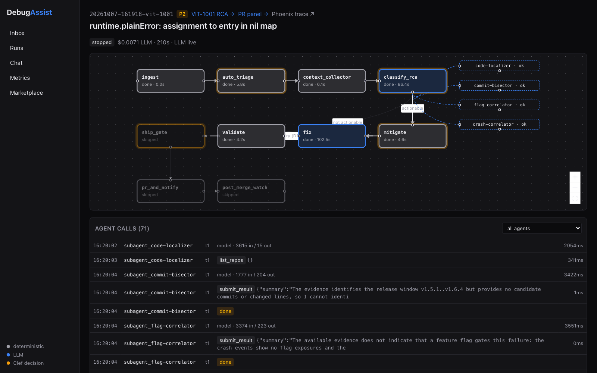</a><br><sub><b>A run, live</b>: the fixed graph with per-step timing, the root-cause subagents, and every model and tool call (here: a Go nil-map panic, validated at the unit tier for under a cent).</sub></td>
</tr>
<tr>
<td width="50%"><a href="docs/screenshots/20-dashboard-runs.png">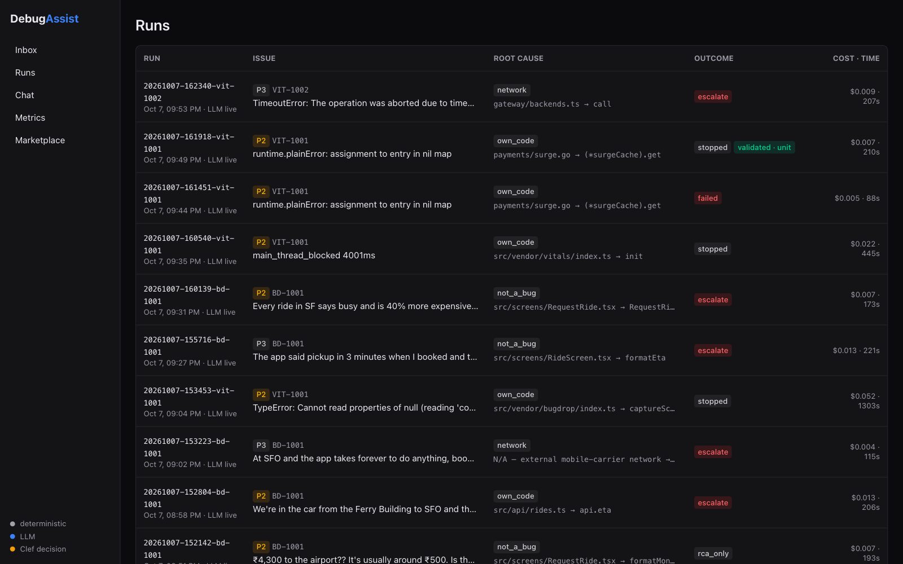</a><br><sub><b>Runs</b>: category and location of each root cause, outcome, cost, time.</sub></td>
<td width="50%"><a href="docs/screenshots/22-dashboard-metrics.png">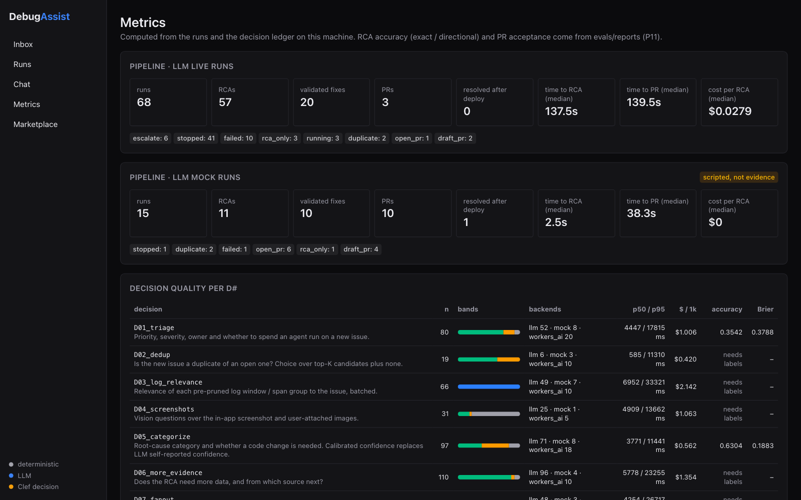</a><br><sub><b>Metrics</b>: live vs scripted runs kept apart; decision quality per template.</sub></td>
</tr>
<tr>
<td width="50%"><a href="docs/screenshots/23-dashboard-marketplace.png">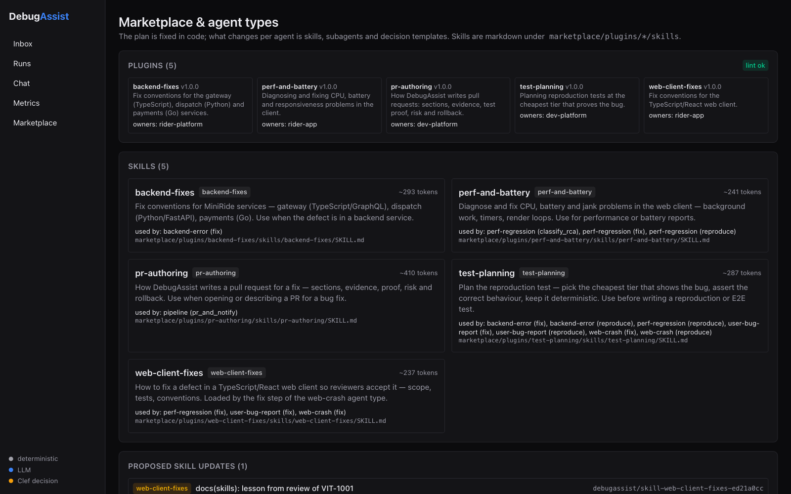</a><br><sub><b>Marketplace</b>: five plugins, skills loaded on demand within a token budget, proposed skill updates from reviews.</sub></td>
<td width="50%"><a href="docs/screenshots/19-dashboard-inbox.png">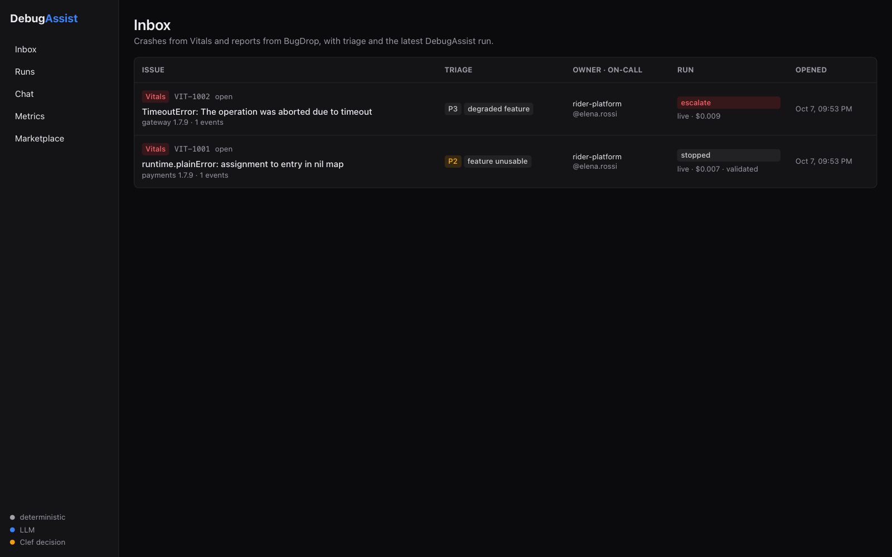</a><br><sub><b>Inbox</b>: Vitals crashes and BugDrop reports with their triage and latest run.</sub></td>
</tr>
</table>

## 🐞 A real bug, end to end

MiniRide 1.6.1 shipped a performance change behind the `notif_router_v2` flag (5% rollout): deep links from push notifications stopped waiting for the persisted session to load. Tap *"your driver is arriving"* right after launch and the app crashes.

<table>
<tr>
<td width="50%">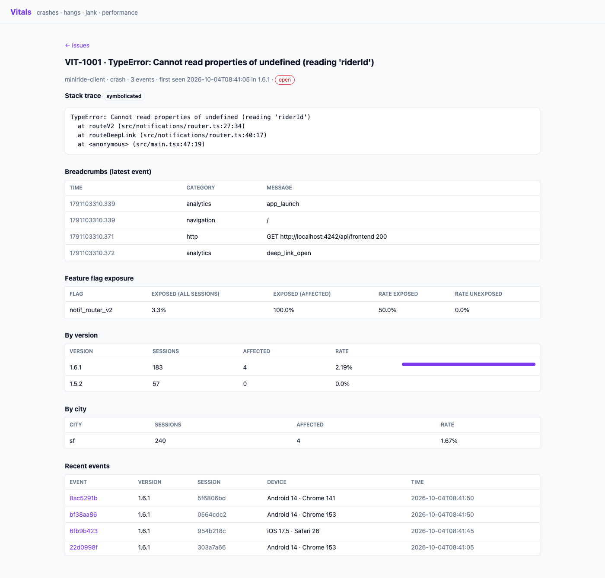<br><sub><b>Vitals</b> groups the crash: symbolicated <code>routeV2 (router.ts:27)</code>, and every crashing session has the flag on.</sub></td>
<td width="50%">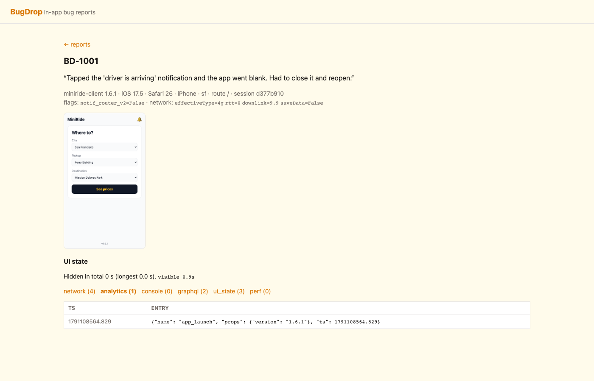<br><sub><b>BugDrop</b>: a rider's in-app report with screenshot, UI-state timeline and logs.</sub></td>
</tr>
<tr>
<td width="50%"><a href="docs/screenshots/10-run-report-root-cause.png">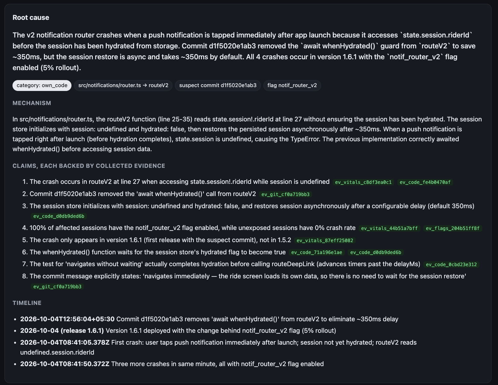</a><br><sub><b>Root cause</b>: claims that each cite collected evidence, and the timeline back to the commit.</sub></td>
<td width="50%"><a href="docs/screenshots/13-run-report-validation.png">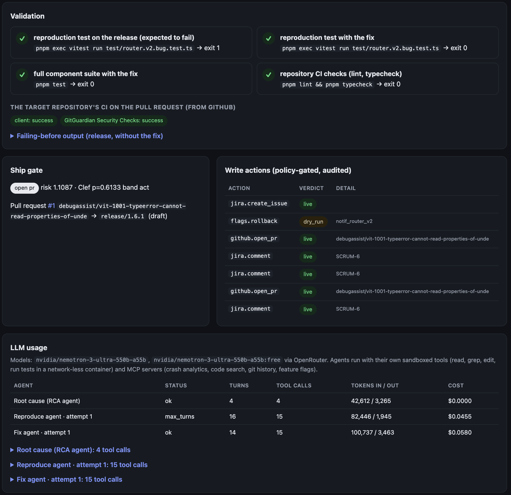</a><br><sub><b>Validation</b>: fails on the release, passes with the fix, suite and CI checks pass; every write audited.</sub></td>
</tr>
<tr>
<td width="50%"><a href="docs/screenshots/16-github-pr-diff.png">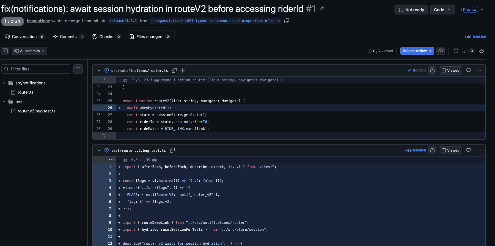</a><br><sub><b>The pull request</b>: the one-line fix and its regression test.</sub></td>
<td width="50%"><a href="docs/screenshots/17-github-pr-checks.png">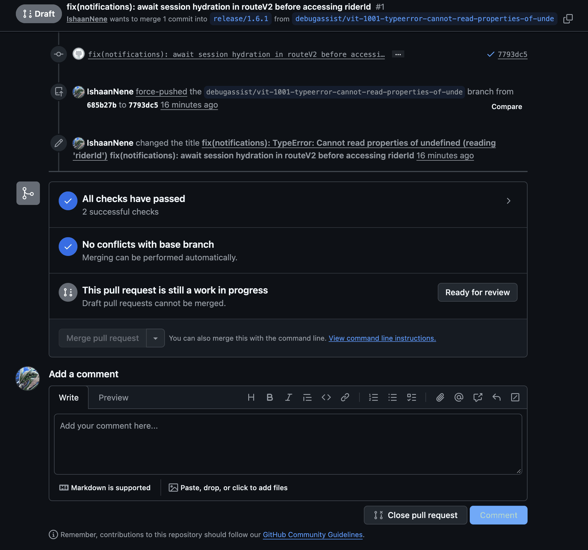</a><br><sub><b>The repo's own CI</b> on the PR: all checks passed.</sub></td>
</tr>
</table>

DebugAssist traced the crash to the commit that removed `await whenHydrated()` from `routeV2`, wrote a test that fails on 1.6.1 with the production error, restored the one-line guard, proved it, and opened a pull request against the release branch, linked from the Jira ticket. More screenshots (Jaeger traces, the Unleash flag, the run report, Jira) are in [docs/screenshots](docs/screenshots/README.md).

## 🧪 The bug catalog

MiniRide is this project's own small ride-hailing system — a React web client and three services (GraphQL gateway in TypeScript, dispatch in Python/FastAPI, payments in Go) with OpenTelemetry, Postgres, Redis and Unleash flags. The catalog injects **25 bugs** into its two repos as natural-looking release commits that pass the repos' own lint and tests, then drives a **Playwright rider fleet** into them until Vitals or BugDrop notices.

| Kind | Bugs | Examples |
|---|---|---|
| Needs a code fix | 19 (TypeScript, Python, Go) | a city with no centre entry crashes search · JPY divided by 100 · an invalid time zone · snake_case vs camelCase between services · a dropped city filter · a nil map · a tariff off by 10× · CORS origins split wrongly · duplicate ride requests on weak networks |
| Not our bug | 6 | a database incident · a carrier outage · a WebView-only crash · intended behaviour · a flag rolled out to 100% · a bad vendored SDK sync |

Each bug has a hidden test and a reference fix; `make verify-scenarios` checks that the regression applies, the hidden test fails on it and the fix passes. The answer key lives in `groundtruth/` and is never mounted into a sandbox.

## 🧰 Agent harness

- **Agent types** — `web-crash`, `backend-error`, `perf-regression`, `user-bug-report`: per-node limits, MCP servers, skills, preferred subagents and validation ladder, resolved from the issue.
- **Marketplace** — five plugins (`pr-authoring`, `test-planning`, `web-client-fixes`, `backend-fixes`, `perf-and-battery`) fetched at a pinned ref; skills are listed by name and loaded on demand within a token budget; `make lint-skills` keeps them generic.
- **Domains** — rider, dispatch, payments and platform knowledge bases with owners, loadable as `kb/<domain>/<doc>`.
- **Packaging** — each agent type builds into a PEX stored in MinIO and a runtime image; runs can be queued to Arq workers.
- **Observability** — every run is one trace (OpenInference spans for agents, tools and Clef decisions) in Phoenix, Langfuse or both (`DA_TRACING`; `make langfuse` self-hosts Langfuse); eval sweeps go to Langfuse as experiments with per-bug scores (`debugassist eval langfuse`); prompt-cache hits and cost are recorded per agent turn; a global run budget stops runaway spend.

## 🔌 MCP servers

Eleven [Model Context Protocol](https://modelcontextprotocol.io) servers with 55 tools (FastMCP over stdio) are the only way agents see production. Each agent type gets the subset it needs; the deterministic context collector calls the same functions directly. Every result carries a stable **evidence id** that RCA claims must cite, is **PII-redacted** before it leaves the server, and is **paginated and capped** (12K chars by default) so one tool call can't flood the context; logs are collapsed into templates and traces summarised. They also work from any MCP client through the committed [`.mcp.json`](.mcp.json).

| Server | Backed by | Tools | Used by |
|---|---|---|---|
| **crash-analytics** | Vitals | `list_issues` `get_issue` `get_crash_group` `get_session` `distribution` `flag_exposure` `crash_rate_timeseries` `releases` | all agent types |
| **code-search** | the target repos | `list_repos` `search_code` `read_file` `find_symbol` `find_references` `blame` `codeowners_for` | all agent types |
| **git-history** | git | `list_tags` `previous_release` `commits_between` `commit_details` `diff_stats` `bisect_candidates` | all agent types |
| **feature-flags** | Unleash | `list_flags` `get_flag` `rollout_history` `flag_crash_correlation` `rollback_flag` | web-crash |
| **bug-reports** | BugDrop | `list_reports` `get_report` `get_logs` `get_screenshots` `get_screenshot_image` `get_ui_state_timeline` | user-bug-report, perf-regression |
| **logging** | Loki | `query_logs` `log_stats` `log_patterns` | backend-error, user-bug-report |
| **tracing** | Jaeger (OTLP) | `find_traces` `get_trace` `service_dependencies` | backend-error, user-bug-report |
| **metrics-profiles** | Prometheus + client perf samples | `promql` `service_profile` `session_perf` | perf-regression, user-bug-report |
| **incidents** | incident service | `list_active_incidents` `incident_details` `dependency_status` | backend-error, context collector |
| **releases** | Vitals sessions + git tags + Unleash | `list_releases` `version_adoption` `release_diff` `rollout_status` `last_good_and_first_bad` | context collector |
| **jira** | Jira Cloud (or mock) | `get_issue` `find_open_issue` `create_issue` `add_comment` `link_pr` `transition` | pipeline nodes only, never agents |

The one write tool an agent can reach, `rollback_flag`, asks the policy gate first ([`writes.yaml`](configs/policies/writes.yaml) says *approval*), so from an agent it is always a dry run, and it is audited either way. Ticket writes happen only in deterministic pipeline steps. Tool reference: [docs/mcp.md](docs/mcp.md).

## 🧠 LLM providers

Agents and the LLM decider use any OpenAI-compatible API; two providers are integrated and tested live.

| Provider | Model | Notes |
|---|---|---|
| **OpenRouter** | `openai/gpt-6-luna` (current) | Tools, strict structured outputs and `seed` on every host. OpenAI-hosted models route to one host so prompt caches hit; cache reads are priced. |
| **GroqCloud** | `openai/gpt-oss-120b` | Free plan works: requests are held under its tokens-per-minute limit by a token budget and history trimming. |

`LLM_PROVIDER` / `LLM_MODEL` pick them; capabilities and prices are read per model, so the pipeline adapts: native JSON schema or function calling, reasoning effort only where supported, and `LLM_STRUCTURED_OUTPUTS=false` for models whose structured-output hosts are scarce. Decisions themselves come from **Cloudflare Clef** on Workers AI. See [ADR 0007](docs/adr/0007-llm-providers.md) and [PLAN A11–A13](docs/PLAN.md).

## 🛡️ Guardrails

- **Sandboxed agents** — commands run in `docker run --network none` on a per-run git worktree, as the host user with no capabilities and the worktree's `.git` read-only; only dependency install gets network. Host code treats the worktree as untrusted: git runs with an explicit, verified git dir and no hooks or fsmonitor, and file walks never follow symlinks. Path and command guards on the agent's tools catch mistakes; the container is the boundary.
- **Policy-gated writes** — pushes only to `debugassist/*` branches of the two demo repos and of repositories the GitHub App is installed on (draft PRs only there, enforced in code); every write — PR, issue comment, Jira, chat, flag — goes through [`configs/policies/writes.yaml`](configs/policies/writes.yaml) and the audit log records what was actually done; flag rollbacks need approval. Credentials reach git through its environment, never argv, and errors and traces are redacted before they are stored.
- **Proof before PR** — no PR without a reproduction that fails on the release; no ready PR without failing-before / passing-after evidence and green CI checks.
- **Untrusted input stays data** — bug reports, logs and commit messages are fenced as data, never followed as instructions (with injection fixtures in the tests); ground truth never reaches the agent.
- **Mock mode everywhere** — every integration has a mock; CI runs with no secrets.

Each promise and the test that fails if it stops being true (the full threat model is in
[docs/THREAT-MODEL.md](docs/THREAT-MODEL.md)):

| Promise | Enforced by |
|---|---|
| A planted `.git` never runs a command in host git | [`test_hostgit.py`](packages/core/tests/test_hostgit.py) |
| Host-side `grep` and code search never follow a symlink out of the worktree | [`test_workspace_tools.py`](packages/llm/tests/test_workspace_tools.py), [`test_properties.py`](packages/core/tests/test_properties.py) |
| Containers run with no network, no capabilities and a read-only `.git` | [`test_hostgit.py`](packages/core/tests/test_hostgit.py) (container flags) |
| Every external write asks the policy gate | [`test_gated_writes.py`](packages/pipeline/tests/test_gated_writes.py) |
| PRs outside the policy's own repositories are drafts | [`test_ship.py`](packages/pipeline/tests/test_ship.py) |
| No PR without a reproduction that fails on the release; no ready PR without validation | [`test_proof_path.py`](packages/pipeline/tests/test_proof_path.py), [`test_ship_and_report.py`](packages/pipeline/tests/test_ship_and_report.py) |
| Edited tests, harness config or added skips cannot make a fix "validated" | [`test_proof_path.py`](packages/pipeline/tests/test_proof_path.py), [`test_harness_config.py`](packages/pipeline/tests/test_harness_config.py) |
| No credential in run state, node files, traces or a failed push's error | [`test_graph_errors.py`](packages/pipeline/tests/test_graph_errors.py), [`test_github_app.py`](packages/integrations/tests/test_github_app.py), [`test_redaction.py`](packages/core/tests/test_redaction.py) |
| Injected instructions are stopped by a named control | [`test_redteam.py`](packages/evals/tests/test_redteam.py) (32 payloads), [`test_injection.py`](packages/pipeline/tests/test_injection.py) |
| Webhook deliveries are signed, GUID-named and never replayed | [`test_api.py`](packages/api/tests/test_api.py) |
| The API's paid POSTs need the dashboard's origin or a token | [`test_api.py`](packages/api/tests/test_api.py) |
| The dev stack listens on 127.0.0.1 only; queue jobs are JSON, never pickle | CI `compose` job, [`test_harness.py`](packages/harness/tests/test_harness.py) |
| An exported `GITHUB_TOKEN` never makes pushes live | [`test_settings.py`](packages/core/tests/test_settings.py) |

## 🗂️ Repository map

| Path | |
|---|---|
| [`packages/pipeline`](packages/pipeline) | the LangGraph pipeline, fix planning, validation ladder, Playwright e2e tier, post-PR tools |
| [`packages/decisions`](packages/decisions) | Clef engine, 18 decision templates, policy bands, ledger, fallbacks and the LLM decider |
| [`packages/llm`](packages/llm) | agent runner (LangChain + MCP), watchdog, token budgets, cache-aware cost |
| [`packages/mcp_servers`](packages/mcp_servers) | the 11 MCP servers |
| [`packages/harness`](packages/harness) | agent types, marketplace, skills, domains, PEX + runtime images, workers |
| [`packages/evals`](packages/evals) | scoring, catalog labels, decision metrics, E1 replay, reports |
| [`packages/scenarios`](packages/scenarios) · [`packages/simulator`](packages/simulator) | bug injection and the Playwright rider fleet |
| [`packages/api`](packages/api) · [`apps/dashboard`](apps/dashboard) | read API with live stream · Next.js dashboard |
| [`sources/`](sources) | Vitals, BugDrop and the incident service (this project's stand-ins) |
| [`targets/`](targets) | MiniRide client and services (git submodules) |
| [`groundtruth/`](groundtruth) · [`evals/`](evals) | the catalog's answer key · runs and reports |

## 🧱 Built with

<div align="center">
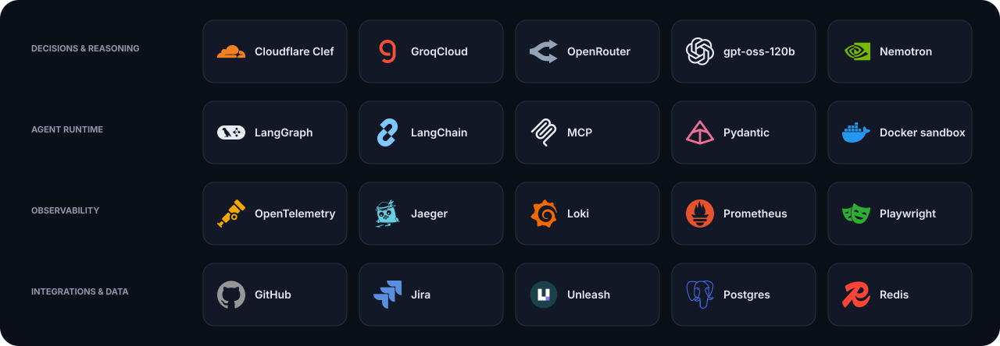
</div>

## 📍 Status

Built phase by phase ([plan](docs/PLAN.md) · [progress](docs/PROGRESS.md) · [architecture](docs/ARCHITECTURE.md) · [decisions](docs/adr/) · [lessons learned](docs/LESSONS.md) · [roadmap](docs/ROADMAP.md)). Done: P0–P14 (decision engine, target system and sources, the full pipeline with 11 MCP servers, triage and RCA, fix planning and the e2e tier, PRs and post-merge watch, dashboard, feedback loop, agent harness, observability and cost controls, the evaluation harness, cross-repo hand-off), P16's Langfuse integration and P17's public site; a three-seed run of the catalog with a fix round and a Clef-vs-LLM ablation; a clone that runs every test and rebuilds the report without the private repo; five real open-source bugs; four attempts to widen narrow fixes; a bisect proof of the culprit commit; and a GitHub App for labeled issues on any repository it is installed on. Measured and parked, off by default: P15's context-engineering switches and the model-based fix-width checks ([parked](docs/ROADMAP.md#parked-2026-10-14)).

**Next** ([roadmap](docs/ROADMAP.md)): the GitHub App on a first real repository; live runs of the call-variation check with all its parts and of the bisect proof, and more real bugs — other languages, larger repos, reports that define or decorate methods — to test it on code it was not designed from; then decide whether to turn it on · prove or rework Clef (D01 triage and D14 test tier first) · LiteLLM and local models. Everything that went wrong on the way, and what fixed it: [lessons learned](docs/LESSONS.md).

<br>

<div align="center">
<sub>
Independent open-source project, inspired by the talk <i>“MCP-Powered Crash Investigation”</i> (Kriti Dangi, Uber, AGNTCon + MCPCon Japan 2026).<br>
Not affiliated with Uber, Cloudflare, OpenAI, Groq, OpenRouter or any other company named here; logos are trademarks of their owners and indicate integrations only.<br>
Vitals and BugDrop are this project's own stand-ins for crash analytics and in-app bug reporting.
</sub>
</div>
