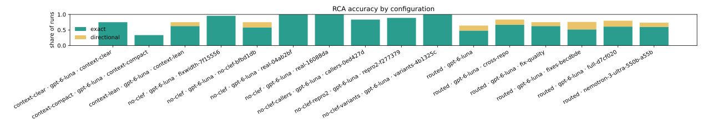
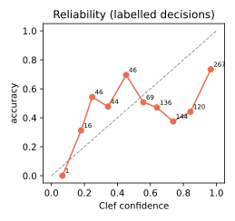
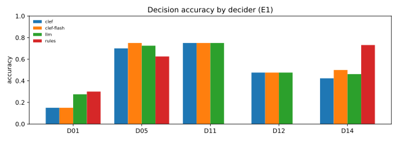

# DebugAssist evaluation — 2026-10-16

Generated by `debugassist eval report` from 39 eval run(s) and 1 decision replay(s) at
commit `4b1325c`. Every number below comes from files in `evals/runs/` and the decision ledger; nothing is hand-entered.

## How to read this report

**Arms.** All runs use `openai/gpt-6-luna`. Arms are code versions, not a controlled comparison:
- `routed · gpt-6-luna` is the 2026-10-07 baseline: every catalog bug, end to end (triage → RCA → mitigation → fix → validation), one seed, on the code of that day. It is the "before" of every re-run below; the headline is now `full-d7cf020`.
- `routed · gpt-6-luna · cross-repo` re-runs the six services bugs that riders reported through the app (BUG-013, 014, 015, 017, 019, 020) on the code with the cross-repo hand-off (ROADMAP P14, commit `a67d35a`): investigation agents see every target repo, and the fix moves to the repo that holds the defect. Compare these rows with the same bugs in the baseline arm; the other 19 bugs were not re-run. The `arm` label was added to these rows after the runs; the BUG-020 rerun also included the connection-error retry fix (`a67d35a-dirty`).
- `routed · gpt-6-luna · fix-quality` re-runs eight bugs (BUG-004, 013, 014, 015, 016, 017, 019, 020) on commit `85cb379`, after three fixes found by reading failed runs: the Python sandbox lost its interpreter between containers (no dispatch test could run, so no reproduction and no fix), `--until validate` ended every eval run after its first validation (the retry loop was never exercised; eval runs now stop after the ship gate, so outcome is measured too), and the edit tool rejected near-miss edits (a gateway fix spent 14 of 20 turns on indentation mismatches). Compare with the same bugs in the baseline and cross-repo arms.
- `context-lean · gpt-6-luna · context-lean` re-runs the same eight bugs on commit `1ae93f2` with `DA_CONTEXT=lean` (ROADMAP P15 items 2, 4, 8): every file read is capped at 120 lines with a pointer to a new `outline_file` tool (symbols with line numbers), and long `run_command` output keeps its failure lines and tail in the history, the rest behind `read_log`. Compare with the fix-quality arm, and see "Context by arm" for tokens. A first lean sweep on `8f1d596` was stopped after one bug: its window applied only to reads without a range, and agents always name one (1–180, 1–260), so it changed nothing; that row is excluded.
- `context-clear · gpt-6-luna · context-clear` re-runs the same eight bugs with `DA_CONTEXT=clear` (ROADMAP P15 item 3; commit `73ecbce`): once the tool output not yet cleared, beyond the newest three results, passes 4K tokens, every older large result is replaced by a one-line stub (tool, arguments, size, evidence id) in one batch, and the boundary stays put until the threshold is crossed again, so the request prefix is unchanged between batches. A first sweep at 8K was stopped after one bug: the trigger never fired on its short agents, and replaying the fix-quality transcripts showed 8K would fire in 6 of 24 agents (4K: 10); that row is excluded.
- `context-compact · gpt-6-luna · context-compact` (**partial: three of the eight bugs**, BUG-004, 013, 014 — the OpenRouter key ran out and the sweep stopped before BUG-015) runs with `DA_CONTEXT=compact` (ROADMAP P15 item 7; commit `d87ed09`): once the steps older than the newest two pass 4K tokens, the same model folds them into structured working notes (goal, findings with evidence ids and file:line, hypotheses, ruled out, changes, commands, next step), and the model is sent the task, the notes and the newest steps; the notes' own model calls count in the run's cost. Its "Context by arm" row covers only those three bugs. A first sweep was stopped after one bug: its trigger also counted the newest steps, which are never folded, so one large recent result re-triggered a compaction almost every turn; that row is excluded.

- `full-d7cf020` is the **headline**: **every catalog bug, three seeds each**, on commit `d7cf020` — the code after the cross-repo hand-off, the fix-quality round and the generic prompt fixes of 2026-10-10 (vendored code is routed, device/OS confinement, transport failures, wider reproduction tests). 74 counted runs. The sweep was resumed once after a network outage (BUG-015 onward, run dir `20261011-025805`); only harness code changed between the two halves (compose retries on DNS errors, stale-worktree cleanup), so both halves carry the same arm.

**Headline, three seeds on current code (`full-d7cf020`, 74 runs) against the one-seed baseline (25 runs).** Root cause right or close 80% (baseline 64%), exact 61% (48%), category right 72% (72%), code bugs with a validated fix 86% (63%), hidden tests passing 74% (47%), median cost per run $0.016 ($0.017). Most of the gain is in the bugs the cross-repo and fix-quality rounds targeted: BUG-004, 015 and 016 now pass every lane in all three seeds, BUG-014 two of three. Ten code bugs pass every lane — root cause right or close, fix validated, hidden test — in all three seeds: BUG-002, 004, 005, 007, 008, 010, 011, 012, 015, 016.

**Where it still misses, read from the runs.** Each is a pattern, not a one-off; the generic fixes are listed under "Next".
- *Fix narrower than the regression.* BUG-003: exact root cause and a validated fix in all three seeds, but the hidden test fails every time — the fix reuses the retry's idempotency key and keeps the shortened request timeout that the same commit introduced. BUG-009 (hidden test 1 of 3): two fixes add the missing city to a lookup table and leave the crash for the next city that lacks one.
- *An active incident outweighed by code that looks suspicious.* BUG-006, 0 of 3: the database incident was in the evidence, active and overlapping the reports, yet every run blamed the client's retry code and opened a pull request.
- *Stopping where the symptom surfaced.* BUG-018, 0 of 3: every run started from the gateway's timeout and concluded at the gateway's outbound call instead of following it into payments. BUG-017, 0 of 3: every run blamed the client's gateway URL rather than the gateway's CORS change, although the gateway was serving other requests at the same time.
- *A plausible release change taken as the cause.* BUG-022, 0 of 3: the crash is confined to one WebView build, but the release also updated a vendored SDK, and every run blamed that update (and attempted fixes, ~$0.10 a run) although the same release was healthy on every other device.
- *Unconfirmed mechanism, escalated.* BUG-020: exact root cause in all three seeds and no fix in any — each RCA said the formula was "unconfirmed" without reading it, and D13 escalated every run to a human.
- *Right answer, wrong route.* Seven runs named the correct not-our-code category and still attempted code fixes, which costs the "exact" verdict and five to ten times the tokens: BUG-024 (flag misconfiguration, all three seeds — the flag was even named), BUG-025 (vendored SDK, all three), BUG-021 seed 3. The graph routes on Clef's pre-RCA category decision (D05) only and never reads the RCA's own category; and the flag-rollback step needs a crash fingerprint, so a rider report never reaches it.
- *A regression from the 2026-10-10 prompt fixes.* BUG-013 seed 2 labelled our own backend `third_party_lib` — the new vendored-code guidance made "not ours" too easy to reach.
- *Run-to-run variance.* BUG-014 seed 1 gave up without reading the client code; BUG-023 seed 3 called expected behaviour a defect; in BUG-001 seed 2, D02 deduplicated the BugDrop report into the Vitals crash and the run continued on the crash (both are the same bug; dedup inputs are identical across seeds, so this is the model's variance, not a leak).

**Next.** Eight generic RCA-prompt rules (cover every behaviour the regression commit changed; fix the condition, not the reported input; our services are own code; an active incident with no correlating change is infra; check the endpoint served other requests before blaming its address; follow a failed outbound call to the service it called; read the code before submitting a mechanism; a release correlates only if failures follow it across devices) and a routing fix (route by the RCA's category; propose flag rollbacks for reports without a fingerprint), then a re-run of the affected bugs as their own arm.

**Fix arm (`fixes-becdbde`), stopped early on purpose.** The eight RCA-prompt rules (`9c3114e`) and the routing fix (`becdbde`) were re-run on the bugs they target, three seeds each, plus four bugs that passed as regression checks (one seed: BUG-002, 007, 015, 023 — all still pass; BUG-007 is the `flag_config` bug that needs a PR, and it still gets one). The arm was stopped after eight of the eleven targeted bugs: the gains had come from routing and fix width, and the remaining misses moved in both directions with each new rule, so further prompt tuning was judged not worth the time. BUG-017 has one run in this arm (directional); 017, 018 and 020 keep their three-seed results from `full-d7cf020`, and one-seed runs never replace three-seed ones in the headline grid. Before → after, three seeds each:
- BUG-022 (WebView crash): wrong ×3, $0.10 a run → **exact ×3**, $0.011 — the release-correlation rule plus routing.
- BUG-025 (vendored SDK): directional ×3 (right category, then code fixes) → **exact ×3**, $0.012.
- BUG-024 (flag misconfiguration): directional ×3 → **exact ×2**, one wrong (`own_code`, no flag named), $0.010. D11 abstained on the rollback for a rider report (`safe_default`); the code fix was skipped because D14 found no tier that reproduces it, so the right outcome came from a different route than intended.
- BUG-003 (duplicate rides): hidden test 0/3 → **2/3** — fixes now restore the timeout as well as the retry key.
- BUG-009 (Tokyo crash): hidden test 1/3 → **2/2** (one seed escalated without a fix).
- BUG-006 (database incident): wrong ×3 → wrong ×3. The incident was in the bundle and the incident-checker subagent named it, but the RCA still blamed client code. Next step if resumed: give D05 (the pre-RCA category decision) the active incidents, which it does not see today.
- BUG-013 (gateway ETA): directional 1 of 2 → wrong ×3 — one run named the gateway but no file ("not established"), one gave up, one blamed dispatch. Worse than before.
- BUG-021 (carrier degradation): exact ×2, directional ×1 → directional ×3 — now `infra` in every seed: the new rule that an active declared incident is infra applies to the carrier incident too. Still routed, no fix attempted.

**Headline grid, each bug's latest three-seed run** (17 bugs from `full-d7cf020`, 8 from `fixes-becdbde`, 75 runs): root cause right or close 80% (80%), exact 65% (61%), category 72% → 75%, code-bug fixes validated 81% (86% — BUG-013 and one BUG-009 seed produced no validated fix), hidden tests 80% (74%), median $0.014 per run ($0.016). The fix arm cost $0.44.

**Clef vs no Clef, end to end (`no-clef-bfbd1db`).** The same pipeline with an LLM making every Clef decision (`DA_DECIDER=llm`, self-reported confidence), one seed, on the pipeline code of `becdbde` (the arm is labelled with `bfbd1db`; later commits changed only docs and the site). It ran in two parts — 15 bugs, then the OpenRouter key expired, then BUG-016..025 with a new key (run dirs `20261011-123202`, `20261014-110957`); BUG-012 was not discovered (the scenario raised no issue), so 24 compare. Against each bug's latest Clef runs (three seeds; the eight re-run bugs on the same code, the rest on `d7cf020`), as the mean of per-bug pass rates — root cause right or close 0.79 (Clef) vs 0.75 (no Clef), exact 0.64 vs 0.58, code-bug fixes validated 0.80 vs 0.78, hidden tests passing 0.67 vs 0.61, median cost per run $0.016 vs $0.015. **A small edge for Clef, within noise** (one seed against three): the gaps come from single bugs and go both ways. Decisions that mattered: BUG-020 — Clef's D13 escalated it to a human in all three seeds, the LLM decider let it be fixed and its hidden test passed; BUG-023 and BUG-024 — right with Clef in two of three seeds, wrong without. RCA swings, not decisions: BUG-011 was lost because the RCA concluded `not_a_bug` (the LLM decider had said `own_code`, and the new routing trusted the RCA), BUG-006 was won because the RCA concluded `infra` (the decider had said `own_code`, as Clef did). Together with the decision replay (E1), where Clef matches or trails the LLM decider and rules win on D01 and D14, the claim that Clef decisions improve outcomes is not established on this catalog. A side effect of routing on the RCA's category shows here: a wrong "not ours" RCA now ends the run without a fix.

**A real open-source bug (`real-04ab2bf`, REAL-001).** [tkem/cachetools#435](https://github.com/tkem/cachetools/issues/435) — calling a `cachedmethod` through its class raises `AttributeError` (filed 2026-10-07, fixed upstream 2026-10-11 in [#436](https://github.com/tkem/cachetools/pull/436)). Input: the frozen issue (`sources/github/issues/cachetools-435.yaml`) with its last three paragraphs withheld because they named `_DescriptorBase.__get__` and proposed the fix; the repo at the fix's parent `0985ec0` with every later commit, branch and tag removed, plus one local commit adding `.DebugAssist/pipeline.yaml`. Answer key: the fix's location, and upstream's regression test (`UnboundMethodTest`, verbatim) as the hidden test — verified by hand to fail on the buggy commit and pass with the upstream fix. Three runs, none excluded, with the LLM decider (Clef returned 401 from this machine after a network change): root cause **exact 3/3**, every run naming commit `57d2e48` (7.0.3, "Handle obj=None case for inspection") as the cause (not scored), fix validated by its own reproduction 3/3, **upstream's test 0/3**, median $0.025 a run. Each fix made the reported positional call work but wrapped the method in a new object, breaking keyword access to the instance (`Cached.get(self=c, value=2)`: "got multiple values for argument 'self'"; one run renamed the parameter to `instance`) and `__wrapped__`. Triage assigned a MiniRide team, because the team catalog only knows MiniRide; it does not affect the score.

**Four more real open-source bugs (`real-16088da`, REAL-002..005).** Built and validated like REAL-001 — frozen issue (parts that named the cause or fix withheld, listed in each case file), history cut at the fix's parent with the fix and any merged PR's branch head verified unreachable, the fix's location and its regression test as the answer key, each checked by hand to fail on the buggy commit and pass with the upstream fix: tkem/cachetools#440 (a failed TTL insertion leaves an unusable entry), python-semver#484 (an `rc3` prerelease bumps back to `rc.1`; the hidden test is adapted from upstream's because the issue accepts `rc4` or `rc.4`), r1chardj0n3s/parse#249 (`{:F}` rejects negative numbers, `f`/`F` reject `nan`/`inf`), more-itertools#1304 (`ichunked(…, 0)` raises instead of yielding nothing). Three runs each with the LLM decider (Clef still 401): root cause exact 12/12; fix validated 11/12 and upstream's test passing 11/12 — the one miss is a semver run that D13 escalated to a human (a change to version-numbering behaviour), with no fix. The run of REAL-005 seed 3 was interrupted by a session restart and rerun with `--start-seed 3` (commit `d776942`, an evals-only change). With REAL-001, all five: root cause exact 15/15, fix validated 14/15, upstream's test 11/15, median $0.014–0.025 a run.

**A prompt experiment for fix width (`fixwidth-7f15556`): no effect, reverted.** Two generic rules were added — the reproduction should also guard the ordinary uses the fix must not break (the same call written the other ways a caller can write it, e.g. positional or keyword arguments; sibling inputs; the unit's signature, return type and attributes callers read), and the fix should change the code where it is wrong and keep the unit's contract. The "positional or keyword" wording was written with REAL-001's failure in mind, so REAL-001 is not a held-out test of it. Re-run with the LLM decider: all five real bugs, three seeds each (REAL-001 has four: seed 1 escalated at D05 and `--start-seed 2 --seeds 3` ran seeds 2–4), and BUG-003, BUG-009. REAL-001's upstream test still failed in every run that made a fix (0/3), the same two ways as before (keyword access to the instance, `__wrapped__`). Over the runs that reached a fix, upstream's test passed 9/12 against 11/14 before — the same four cases passing, the same one failing. BUG-003's hidden test passed 1/3 (2/3 in the last Clef re-run), BUG-009 2/3 (2/3); their earlier runs used Clef, so the decider differs too. Five real-bug runs stopped before any fix (one D05, four D13 escalations, against one in the earlier sweep): those decisions see only the RCA, which these prompts do not touch, so they are decider variance. The prompt change was reverted; this arm is shown in the report but is not part of any headline number.

**A second, independent reproduction (`repro2-f277379`): it passed every fix.** With `DA_SECOND_REPRO=1` (config `no-clef-repro2`, LLM decider), once a fix passes its own reproduction and the suite, a separate agent writes a test from the report alone — on the release, with the fix and every test the fixing agent wrote removed — and the fix must pass it too. Run on the three cases where fixes were too narrow: REAL-001 and BUG-003, three seeds each, and BUG-009 (seed 1 wrong root cause, seed 3 escalated by D13 — neither made a fix). The second test reproduced the bug on the release and passed with the fix in all 7 fixes it checked; the hidden test passed 1/7 (REAL-001 0/3, BUG-003 0/3, BUG-009 1/1). The REAL-001 second tests checked the report's own example — the positional call through the class — not keyword calls or `__wrapped__`, which upstream's test also checks and the report never mentions. A first run of this arm (`repro2-84efb0b`, two REAL-001 runs) is discarded: a bug in the check (`git ls-files` counts intent-to-add files as tracked) threw away every second test as "not checked"; it was fixed in `f277379` before these runs. $0.27 for the arm, $0.07 for the discarded runs. The switch stays in the code, off by default.

**The checker also shown the code's other uses (`callers-0ed427d`): stricter, still no shipped fix passed.** With `DA_SECOND_REPRO=callers`, the checker is also given how the code at fault is used elsewhere in its repository, collected by `pipeline/usages.py` with git grep (no model): the root-cause function and its class, then the identifiers in the report's code that the repository defines, most specific first; docs and type stubs before tests and source; the fault's own file left out. For REAL-001 that is `cachetools`' type stub for the `cachedmethod` wrapper (`__wrapped__`, `__get__`, `__call__(self, /, *args, **kwargs)`) and the docs' `cachedmethod` examples; for BUG-003 (a BugDrop report, no code) the uses of `requestRide`. REAL-001, three seeds: the checker's tests now covered keyword arguments, cache sharing between class and instance access and `cache_info`, and **sent back 3 fixes** that had passed their own reproduction and the suite (seed 1: two, seed 2: one); every shipped fix still failed upstream's test, the same two ways — `Cached.get(self=c, …)` and `__wrapped__` on class access. Nothing in the repository calls a method with `self=`; only upstream's new test does. Upstream's test 0/3; $0.20, about twice the report-only mode per run because of the extra attempts. BUG-003: 0/2 hidden (seed 2 wrong root cause), the checker passed both fixes; $0.06. A first callers arm (`callers-3e70718`, one completed run) is discarded: the report was passed as JSON, so its code block never matched and names came from its prose (`access`, `call`, `has`); fixed in `0ed427d`.

**Call variations, no model (`variants-4b1325c`): narrow fixes stopped shipping as validated; upstream's test still 0/3.** With `DA_CALL_VARIANTS=1`, `pipeline/callvariants.py` parses the report's Python code and, for each call of a method the snippet defines, writes the other spellings of the same call — keyword arguments, mixed, through the instance or the class — each a small program printing the call's repr or exception type; with the fix, every spelling must print what the reported one prints. Checked offline first, without a model run: of the 12 earlier cachetools#435 fixes that passed validation it fails 11 (`Example.value(self=example, number=3)` raises `TypeError`, the reported call returns 6) and passes the one that already handled keywords; upstream's fix passes every spelling. It applies to none of the other four real bugs (their reports call library functions, not methods the snippet defines). Three REAL-001 runs, LLM decider, $0.19: it sent back 4 fixes. Seed 1's retry handled keyword calls and validated — upstream's test then failed on 5 cases instead of 10 (`__wrapped__` on class access, and `cache_info` hit/miss counts), which no spelling tests; seeds 2 and 3 made no fix that passed, so nothing was marked validated. Fix validated 1/3 (3/3 in every earlier REAL-001 arm, all narrow); upstream's test 0/3.

**Scoring.** "Not our bug" cases (BUG-006, BUG-021..025) score *exact* for the right category with no fix attempted, and *directional* for the right category with a fix attempt, or for another not-our-code category with no fix (e.g. `infra` for a carrier outage). The second directional case was added after the first runs were seen; `debugassist eval rescore` re-applied it to every run.

**Exclusions.** Runs listed under "Excluded runs" hit an evaluator or infrastructure fault, not an agent mistake — the Go sandbox image's login shell dropped Go from `PATH`, and one LLM-decider connection error — and were rerun; the reruns are counted instead. In `full-d7cf020`, four rows are excluded: BUG-015's three seeds ran during a network outage (Clef could not be reached before triage; $0 each; rerun in `20261011-025805`), and BUG-013 seed 1 never started because a stale worktree from an earlier run could not be removed (fixed in the sandbox). BUG-013 therefore counts two seeds.

**One seed is noisy.** BUG-014 was solved end to end in the cross-repo arm and missed in the fix-quality arm, where the RCA agent concluded the evidence did not explain the disabled button and escalated. Same bug, different run: read single-bug changes between arms with care. The headline arm now runs three seeds per bug; its grid shows how many seeds passed, and seeds still disagree on at least one lane for eight bugs (BUG-001, 009, 013, 014, 017, 018, 019, 023).

**Environment drift between sweeps.** BUG-004's `gps_loss` scenario nulls driver coordinates, and until commit `df04c0e` the wipe between bugs never restored them, so each sweep ran with fewer located San Francisco drivers than the one before. It surfaced when BUG-020 could no longer be discovered in the clear arm (riders were matched to drivers 5 km away and never saw the in-trip ETA); those two attempts are excluded and BUG-020 was rerun after the wipe was fixed to re-seed the fleet. Earlier arms ran on a partly drained fleet too, which may affect bugs that depend on matching; it is one more reason to read single-bug differences between arms with care.

**Limits.** 25 synthetic bugs injected into our own small app, three seeds per bug in the headline arm and one in the others: enough to see strengths and gaps, not to quote precise rates. The catalog and the agent skills were written by the same person (skills are generic and linted for leaks). Decision accuracy, calibration and the decision replay use only decisions logged by the runs in this report.

**Scorer fix before this report.** The first draft credited a client-repo answer as *directional* for a services bug (the path normaliser prefixed the component to any path, so `src/screens/RequestRide.tsx` matched `payments/`). It now honours the repo the agent names and only treats a path as component-relative when it shares that component's leading directories; covered by tests; every run was re-scored. Earlier attempts that never produced a pipeline result (provider 429s, a mitigation crash, a dedup bug in the evaluator, all fixed) are kept out of `evals/runs/`.

## Findings

- **Compaction with notes: no saving on the three bugs it reached.** Input per turn matched the fix-quality arm — the notes and the compaction calls cost about what they removed — and BUG-013's run climbed three reproduction tiers (unit → integration → e2e), which more than doubled the arm's total. The notes themselves were good (exact file:line and evidence ids carried over). Three bugs, one seed: inconclusive, kept opt-in, to be finished when there is credit.
- **Clearing old tool results cut tokens modestly; it did not pay for itself.** See "Context by arm": input per turn fell and so did input per run, but the cache hit rate fell too (each batch rewrites the cached prefix once), so cost moved by only a few percent. Root cause right or close matched the fix-quality arm; hidden-test passes were lower (BUG-004's fix returned no estimate where one is expected; BUG-019's root cause was wrong) — within one-seed noise, but not a reason to switch it on. Kept opt-in, like lean.
- **Lean context did not save tokens.** See "Context by arm": capping reads made agents read more often, so `read_file`'s share of input went up, not down, and input per run rose; the higher cache rate kept cost about level. Most of the total is one run: on BUG-017 the D14 tier decision chose the e2e tier instead of unit, and three fix attempts each used every turn. Outcomes are within one-seed noise (BUG-013 was wrong this time, though the file it needed was 110 lines and was read whole; BUG-014 was exact). Verdict: keep `DA_CONTEXT=lean` as an opt-in switch, not the default. Per-turn trimming is offset by extra calls; the input that matters is history re-sent every turn, so tool-result clearing and fewer turns (ROADMAP P15 items 3 and 7) are the next things to measure.
- **Backend bugs reported from the app: the baseline's main gap, and what P14 changed.** In the baseline every one of them was localised in the client repo (the agent said the gateway source was not available), and three got a validated client-side workaround that the hidden tests reject. With the cross-repo hand-off, the agent followed the request into the services and the fix moved there (see the cross-repo rows). What still fails: CORS (BUG-017) — the browser shows the client only an opaque `Failed to fetch`, so the agent never looked at the gateway's CORS settings — and several fixes that found the right spot but did not validate (one failed the gateway's typecheck).
- **Not-our-bug cases are mixed.** A carrier outage and intended behaviour were routed correctly, but BUG-022 (WebView-only crash) was blamed on our vendored BugDrop SDK by both models, and BUG-025 (a bad vendored Vitals SDK sync) was localised to the exact function but treated as our own code instead of routed to its owner.
- **Validated is not the same as correct.** Several runs validated a fix whose hidden test still fails (see the runs table): the agent's own reproduction test was narrower than the bug.
- **Decisions.** D01 triage is the weakest decision in both the live ledger and the replay; in the replay the rules baseline matches or beats the Clef models on D01 and D14 — templates to revisit before more ablations.

**Read with care:** 30 bug(s), 255 pipeline run(s) in total. Small n: differences of one or two
runs between configurations are noise. "± x" is the standard deviation across seeds.

## Pipeline, by configuration

| config | runs | bugs | seeds | rca_exact | rca_exact_or_directional | category_ok | outcome_ok | validated | hidden_tests_pass | diff_similarity | unsupported_claims | turns | usd | time_to_rca_s |
|---|---|---|---|---|---|---|---|---|---|---|---|---|---|---|
| context-clear · gpt-6-luna · context-clear | 8 | 8 | 1 | 0.75 | 0.75 | 0.5 | 5/8 | 0.625 | 3/5 | 0.363 ± 0.26 | 0.125 ± 0.33 | 18.4 ± 9.3 | 0.0142 ± 0.0033 | 121 ± 22 |
| context-compact · gpt-6-luna · context-compact | 3 | 3 | 1 | 0.333 | 0.333 | 0.667 | 2/2 | 0.667 | 1/3 | 0.363 ± 0.36 | 0 ± 0 | 32.3 ± 18 | 0.033 ± 0.021 | 141 ± 22 |
| context-lean · gpt-6-luna · context-lean | 8 | 8 | 1 | 0.625 | 0.75 | 0.875 | 4/8 | 0.5 | 4/5 | 0.452 ± 0.4 | 0.125 ± 0.33 | 26.5 ± 24 | 0.0221 ± 0.022 | 144 ± 28 |
| no-clef · gpt-6-luna · fixwidth-7f15556 | 22 | 7 | 4 | 0.964 ± 0.062 | 0.964 ± 0.062 | 0.893 ± 0.062 | 17/22 | 0.821 ± 0.19 | 12/17 | 0.663 ± 0.11 | 0.636 ± 0.64 | 23.9 ± 11 | 0.0184 ± 0.0078 | 9.54e+05 ± 8.6e+05 |
| no-clef · gpt-6-luna · no-clef-bfbd1db | 24 | 24 | 1 | 0.583 | 0.75 | 0.625 | 20/23 | 0.583 | 11/14 | 0.321 ± 0.21 | 0.708 ± 1 | 15.8 ± 8.7 | 0.0143 ± 0.0042 | 82.2 ± 1.9e+02 |
| no-clef · gpt-6-luna · real-04ab2bf | 3 | 1 | 3 | 1 ± 0 | 1 ± 0 | 1 ± 0 | 3/3 | 1 ± 0 | 0/3 | – | 0.333 ± 0.47 | 32 ± 5.4 | 0.0257 ± 0.0035 | 6.51e+05 ± 2.7e+02 |
| no-clef · gpt-6-luna · real-16088da | 12 | 4 | 3 | 1 ± 0 | 1 ± 0 | 1 ± 0 | 11/12 | 0.917 ± 0.12 | 11/11 | – | 0.667 ± 0.47 | 25.4 ± 7.3 | 0.0171 ± 0.0039 | 1.43e+06 ± 7.6e+05 |
| no-clef-callers · gpt-6-luna · callers-0ed427d | 6 | 2 | 3 | 0.833 ± 0.24 | 0.833 ± 0.24 | 0.667 ± 0.24 | 5/6 | 0.833 ± 0.24 | 0/5 | 0.533 ± 0 | 0.667 ± 0.75 | 43.7 ± 29 | 0.043 ± 0.025 | 3.92e+05 ± 3.9e+05 |
| no-clef-repro2 · gpt-6-luna · repro2-f277379 | 9 | 3 | 3 | 0.889 ± 0.16 | 0.889 ± 0.16 | 0.667 ± 0 | 7/9 | 0.778 ± 0.16 | 1/7 | 0.587 ± 0.094 | 0.111 ± 0.31 | 33.9 ± 28 | 0.0297 ± 0.019 | 2.47e+05 ± 3.5e+05 |
| no-clef-variants · gpt-6-luna · variants-4b1325c | 3 | 1 | 3 | 1 ± 0 | 1 ± 0 | 1 ± 0 | 2/3 | 0.333 ± 0.47 | 0/3 | – | 1 ± 0 | 80 ± 18 | 0.0617 ± 0.02 | 7.88e+05 ± 6.7e+02 |
| routed · gpt-6-luna | 25 | 25 | 1 | 0.48 | 0.64 | 0.72 | 3/7 | 0.52 | 7/15 | 0.212 ± 0.16 | 0.44 ± 0.64 | 24.2 ± 13 | 0.0208 ± 0.012 | 116 ± 2e+02 |
| routed · gpt-6-luna · cross-repo | 6 | 6 | 1 | 0.667 | 0.833 | 0.667 | 0/0 | 0.5 | 2/6 | 0.381 ± 0.3 | 0.5 ± 0.76 | 34.7 ± 5.5 | 0.0231 ± 0.0063 | 130 ± 15 |
| routed · gpt-6-luna · fix-quality | 8 | 8 | 1 | 0.625 | 0.75 | 1 | 6/8 | 0.75 | 5/6 | 0.513 ± 0.41 | 0.125 ± 0.33 | 18.8 ± 5.8 | 0.0146 ± 0.0026 | 146 ± 33 |
| routed · gpt-6-luna · fixes-becdbde | 29 | 13 | 3 | 0.513 ± 0.018 | 0.756 ± 0.009 | 0.596 ± 0.041 | 23/29 | 0.346 ± 0.17 | 7/10 | 0.497 ± 0.28 | 0.828 ± 0.87 | 15.1 ± 11 | 0.0153 ± 0.0073 | 331 ± 2.3e+02 |
| routed · gpt-6-luna · full-d7cf020 | 74 | 25 | 3 | 0.609 ± 0.044 | 0.797 ± 0.0038 | 0.717 ± 0.029 | 61/74 | 0.703 ± 0.049 | 37/50 | 0.31 ± 0.26 | 0.392 ± 0.73 | 30.6 ± 28 | 0.0252 ± 0.026 | 528 ± 7e+02 |
| routed · nemotron-3-ultra-550b-a55b | 15 | 15 | 1 | 0.6 | 0.733 | 0.533 | 0/0 | 0.067 | 0/1 | 0 | 3.6 ± 1.4 | 11.3 ± 9.4 | 0.21 ± 0.12 | 202 ± 2.4e+02 |



Definitions: **exact** = file and function match ground truth; **directional** = right file or module; for
"not our bug" cases, exact = routed with the right category and no fix attempted. **hidden tests** = the
catalog's hidden tests pass on the agent's change (run by the evaluator in a copy of the worktree).

## Decisions (labelled from the catalog)

| decision | n | accuracy | brier | ece | coverage_at_tau | accuracy_at_tau | latency_p50_ms | usd_per_1k |
|---|---|---|---|---|---|---|---|---|
| D01_triage | 215 | 0.214 | 0.4602 | 0.5444 | 0.9256 | 0.2312 | 4397.0 | 0.4586 |
| D05_categorize | 215 | 0.6326 | 0.2296 | 0.1509 | 0.2047 | 0.9091 | 3518.0 | 0.2598 |
| D11_mitigation | 15 | 0.6667 | 0.227 | 0.2453 | 0.8 | 0.8333 | 3141.0 | 0.2822 |
| D12_localization | 147 | 0.6327 | 0.3114 | 0.3157 | 0.9864 | 0.6414 | 3171.0 | 0.3643 |
| D14_validation_tier | 181 | 0.5249 | 0.2766 | 0.2846 | 0.9227 | 0.5449 | 3356.0 | 0.1593 |
| D16_ship_gate | 116 | 0.9052 | 0.1629 | 0.2631 | 0.7069 | 0.9146 | 3541.5 | 0.1588 |



## Decision replay (E1): Clef vs Clef-flash vs LLM decider vs rules

| decision | backend | n | accuracy | brier | ece | latency_p50_ms | usd_per_1k |
|---|---|---|---|---|---|---|---|
| D01_triage | clef | 40 | 0.15 | 0.4722 | 0.605 | 5006.0 | 0.2474 |
| D01_triage | clef-flash | 40 | 0.15 | 0.4814 | 0.6172 | 4916.0 | 0.2411 |
| D01_triage | llm | 40 | 0.275 | 0.4212 | 0.4765 | 4754.0 | 0.2423 |
| D01_triage | rules | 40 | 0.3 | None | None | 0.0 | 0.0 |
| D05_categorize | clef | 40 | 0.7 | 0.2308 | 0.2544 | 3949.0 | 0.1355 |
| D05_categorize | clef-flash | 40 | 0.75 | 0.2405 | 0.2617 | 4397.0 | 0.1381 |
| D05_categorize | llm | 40 | 0.725 | 0.2389 | 0.1929 | 4192.0 | 0.1364 |
| D05_categorize | rules | 40 | 0.625 | None | None | 0.0 | 0.0 |
| D11_mitigation | clef | 4 | 0.75 | 0.0684 | 0.1725 | 4301.0 | 0.1091 |
| D11_mitigation | clef-flash | 4 | 0.75 | 0.1232 | 0.195 | 3886.0 | 0.1129 |
| D11_mitigation | llm | 4 | 0.75 | 0.0905 | 0.1675 | 3958.0 | 0.1106 |
| D11_mitigation | rules | 4 | 0.0 | None | None | 0.0 | 0.0 |
| D12_localization | clef | 21 | 0.476 | 0.4863 | 0.493 | 3780.0 | 0.2083 |
| D12_localization | clef-flash | 21 | 0.476 | 0.478 | 0.4812 | 3558.0 | 0.2106 |
| D12_localization | llm | 21 | 0.476 | 0.4732 | 0.4852 | 3722.0 | 0.212 |
| D12_localization | rules | 21 | 0.0 | None | None | 0.0 | 0.0 |
| D14_validation_tier | clef | 26 | 0.423 | 0.3189 | 0.3964 | 5113.0 | 0.155 |
| D14_validation_tier | clef-flash | 26 | 0.5 | 0.302 | 0.3503 | 4989.0 | 0.1493 |
| D14_validation_tier | llm | 26 | 0.462 | 0.3297 | 0.3626 | 6862.0 | 0.148 |
| D14_validation_tier | rules | 26 | 0.731 | None | None | 0.0 | 0.0 |



## Context by arm (`debugassist eval context --name <arm>`)

Input tokens of every agent turn in the arm's runs, split by what they carried (shares of input). The shares assume history only grows; for arms that shrink it (clear) the totals, per-run and per-turn figures are exact and the shares approximate.

| arm | runs | input_tokens | per_run | per_turn | cache_rate | prefix_share | tools_share | model_share | read_file_share | run_command_share |
|---|---|---|---|---|---|---|---|---|---|---|
| clear | 8 | 1251197 | 156400 | 6585 | 0.689 | 0.593 | 0.491 | 0.058 | 0.296 | 0.017 |
| compact | 3 | 1061513 | 353838 | 7928 | 0.587 | 0.363 | 0.805 | 0.08 | 0.634 | 0.006 |
| fix-quality | 8 | 1489795 | 186224 | 7916 | 0.764 | 0.49 | 0.446 | 0.065 | 0.254 | 0.014 |
| lean | 8 | 2517408 | 314676 | 10006 | 0.834 | 0.363 | 0.532 | 0.105 | 0.316 | 0.003 |


## Runs

| bug | config | seed | rca | location | validated | hidden | usd |
|---|---|---|---|---|---|---|---|
| BUG-001 | no-clef · gpt-6-luna · no-clef-bfbd1db | 1 | exact | src/eta/poller.ts → EtaPoller.tick | True | True | 0.02482 |
| BUG-001 | routed · gpt-6-luna | 1 | exact | src/eta/poller.ts → EtaPoller.tick | True | True | 0.02288 |
| BUG-001 | routed · gpt-6-luna · full-d7cf020 | 1 | exact | src/eta/poller.ts → EtaPoller.tick | True | False | 0.02198 |
| BUG-001 | routed · gpt-6-luna · full-d7cf020 | 2 | directional | src/eta/poller.ts → EtaPoller.nextDelay | True | True | 0.01868 |
| BUG-001 | routed · gpt-6-luna · full-d7cf020 | 3 | exact | src/eta/poller.ts → tick | True | True | 0.01939 |
| BUG-001 | routed · nemotron-3-ultra-550b-a55b | 1 | directional | src/eta/poller.ts → refreshLocally | True | False | 0.55225 |
| BUG-002 | no-clef · gpt-6-luna · no-clef-bfbd1db | 1 | exact | src/notifications/router.ts → routeV2 | True | True | 0.01548 |
| BUG-002 | routed · gpt-6-luna | 1 | exact | src/notifications/router.ts → routeV2 | True | True | 0.01346 |
| BUG-002 | routed · gpt-6-luna · fixes-becdbde | 1 | exact | src/notifications/router.ts → routeV2 | True | True | 0.01534 |
| BUG-002 | routed · gpt-6-luna · full-d7cf020 | 1 | exact | src/notifications/router.ts → routeV2 | True | True | 0.01218 |
| BUG-002 | routed · gpt-6-luna · full-d7cf020 | 2 | exact | src/notifications/router.ts → routeV2 | True | True | 0.01214 |
| BUG-002 | routed · gpt-6-luna · full-d7cf020 | 3 | exact | src/notifications/router.ts → routeV2 | True | True | 0.01256 |
| BUG-002 | routed · nemotron-3-ultra-550b-a55b | 1 | exact | src/notifications/router.ts → routeV2 | False | None | 0.08793 |
| BUG-003 | no-clef · gpt-6-luna · fixwidth-7f15556 | 1 | exact | src/api/rides.ts → requestRide | True | True | 0.02156 |
| BUG-003 | no-clef · gpt-6-luna · fixwidth-7f15556 | 2 | exact | src/api/rides.ts → requestRide | True | False | 0.01852 |
| BUG-003 | no-clef · gpt-6-luna · fixwidth-7f15556 | 3 | exact | src/api/rides.ts → requestRide | True | False | 0.01727 |
| BUG-003 | no-clef · gpt-6-luna · no-clef-bfbd1db | 1 | exact | src/api/rides.ts → requestRide | True | True | 0.01971 |
| BUG-003 | no-clef-callers · gpt-6-luna · callers-0ed427d | 1 | exact | src/api/rides.ts → requestRide | True | False | 0.02324 |
| BUG-003 | no-clef-callers · gpt-6-luna · callers-0ed427d | 2 | wrong | dispatch/src/dispatch/app.py → request_ride | False | None | 0.01528 |
| BUG-003 | no-clef-callers · gpt-6-luna · callers-0ed427d | 3 | exact | src/api/rides.ts → requestRide | True | False | 0.02406 |
| BUG-003 | no-clef-repro2 · gpt-6-luna · repro2-f277379 | 1 | exact | src/api/rides.ts → requestRide | True | False | 0.02349 |
| BUG-003 | no-clef-repro2 · gpt-6-luna · repro2-f277379 | 2 | exact | src/api/rides.ts → requestRide | True | False | 0.02801 |
| BUG-003 | no-clef-repro2 · gpt-6-luna · repro2-f277379 | 3 | exact | src/api/rides.ts → requestRide | True | False | 0.02354 |
| BUG-003 | routed · gpt-6-luna | 1 | exact | src/api/rides.ts → requestRide | True | False | 0.01379 |
| BUG-003 | routed · gpt-6-luna · fixes-becdbde | 1 | exact | src/api/rides.ts → requestRide | True | True | 0.02008 |
| BUG-003 | routed · gpt-6-luna · fixes-becdbde | 2 | exact | src/api/rides.ts → requestRide | True | True | 0.02097 |
| BUG-003 | routed · gpt-6-luna · fixes-becdbde | 3 | directional | src/api/rides.ts → unknown | True | False | 0.0174 |
| BUG-003 | routed · gpt-6-luna · full-d7cf020 | 1 | exact | src/api/rides.ts → requestRide | True | False | 0.01574 |
| BUG-003 | routed · gpt-6-luna · full-d7cf020 | 2 | exact | src/api/rides.ts → requestRide | True | False | 0.01822 |
| BUG-003 | routed · gpt-6-luna · full-d7cf020 | 3 | exact | src/api/rides.ts → requestRide | True | False | 0.01625 |
| BUG-003 | routed · nemotron-3-ultra-550b-a55b | 1 | exact | src/api/rides.ts → requestRide | False | None | 0.18131 |
| BUG-004 | context-clear · gpt-6-luna · context-clear | 1 | exact | dispatch/src/dispatch/matching.py → eta_seconds | True | False | 0.01797 |
| BUG-004 | context-compact · gpt-6-luna · context-compact | 1 | exact | dispatch/src/dispatch/matching.py → eta_seconds | True | True | 0.01799 |
| BUG-004 | context-lean · gpt-6-luna · context-lean | 1 | exact | dispatch/src/dispatch/matching.py → eta_seconds | True | True | 0.01285 |
| BUG-004 | no-clef · gpt-6-luna · no-clef-bfbd1db | 1 | exact | dispatch/src/dispatch/matching.py → eta_seconds | True | True | 0.0171 |
| BUG-004 | routed · gpt-6-luna | 1 | exact | dispatch/src/dispatch/matching.py → eta_seconds | False | False | 0.02951 |
| BUG-004 | routed · gpt-6-luna · fix-quality | 1 | exact | dispatch/src/dispatch/matching.py → eta_seconds | True | True | 0.0145 |
| BUG-004 | routed · gpt-6-luna · full-d7cf020 | 1 | exact | dispatch/src/dispatch/matching.py → eta_seconds | True | True | 0.01415 |
| BUG-004 | routed · gpt-6-luna · full-d7cf020 | 2 | exact | dispatch/src/dispatch/matching.py → eta_seconds | True | True | 0.01319 |
| BUG-004 | routed · gpt-6-luna · full-d7cf020 | 3 | exact | dispatch/src/dispatch/matching.py → eta_seconds | True | True | 0.01364 |
| BUG-004 | routed · nemotron-3-ultra-550b-a55b | 1 | exact | src/dispatch/matching.py → eta_seconds | False | None | 0.09733 |
| BUG-005 | no-clef · gpt-6-luna · no-clef-bfbd1db | 1 | exact | payments/surge.go → (*surgeCache).get | True | True | 0.01521 |
| BUG-005 | routed · gpt-6-luna | 1 | exact | payments/surge.go → (*surgeCache).get | True | True | 0.01122 |
| BUG-005 | routed · gpt-6-luna · full-d7cf020 | 1 | exact | payments/surge.go → (*surgeCache).get | True | True | 0.01223 |
| BUG-005 | routed · gpt-6-luna · full-d7cf020 | 2 | exact | payments/surge.go → (*surgeCache).get | True | True | 0.01091 |
| BUG-005 | routed · gpt-6-luna · full-d7cf020 | 3 | exact | payments/surge.go → (*surgeCache).get | True | True | 0.0108 |
| BUG-005 | routed · nemotron-3-ultra-550b-a55b | 1 | exact | payments/surge.go → (*surgeCache).get | False | None | 0.14399 |
| BUG-006 | no-clef · gpt-6-luna · no-clef-bfbd1db | 1 | exact | dispatch/src/dispatch/app.py → request_ride | False | None | 0.0154 |
| BUG-006 | routed · gpt-6-luna | 1 | directional | src/api/rides.ts → requestRide | True | None | 0.05653 |
| BUG-006 | routed · gpt-6-luna · fixes-becdbde | 1 | wrong | src/screens/RequestRide.tsx → RequestRide | True | None | 0.03096 |
| BUG-006 | routed · gpt-6-luna · fixes-becdbde | 2 | wrong |  →  | False | None | 0.01404 |
| BUG-006 | routed · gpt-6-luna · fixes-becdbde | 3 | wrong | src/api/rides.ts → requestRide | True | None | 0.03628 |
| BUG-006 | routed · gpt-6-luna · full-d7cf020 | 1 | wrong | src/api/rides.ts → requestRide | True | None | 0.02263 |
| BUG-006 | routed · gpt-6-luna · full-d7cf020 | 2 | wrong | src/api/rides.ts → RequestRide | True | None | 0.02265 |
| BUG-006 | routed · gpt-6-luna · full-d7cf020 | 3 | wrong | src/screens/RequestRide.tsx → RequestRide | True | None | 0.02612 |
| BUG-006 | routed · nemotron-3-ultra-550b-a55b | 1 | wrong | src/api/rides.ts → requestRide | False | None | 0.29703 |
| BUG-007 | no-clef · gpt-6-luna · no-clef-bfbd1db | 1 | directional | gateway/src/backends.ts → call | True | True | 0.01606 |
| BUG-007 | routed · gpt-6-luna | 1 | directional | gateway/src/backends.ts → call (used by httpBackends.requestRide) | False | False | 0.01703 |
| BUG-007 | routed · gpt-6-luna · fixes-becdbde | 1 | directional | gateway/src/backends.ts → call (used by httpBackends().requestRide) | True | True | 0.02167 |
| BUG-007 | routed · gpt-6-luna · full-d7cf020 | 1 | exact | gateway/src/backends.ts → httpBackends().requestRide | True | True | 0.01512 |
| BUG-007 | routed · gpt-6-luna · full-d7cf020 | 2 | directional | gateway/src/backends.ts → call (used by httpBackends.requestRide) | True | True | 0.01604 |
| BUG-007 | routed · gpt-6-luna · full-d7cf020 | 3 | exact | gateway/src/backends.ts → httpBackends.requestRide | True | True | 0.01258 |
| BUG-007 | routed · nemotron-3-ultra-550b-a55b | 1 | exact | gateway/src/backends.ts → requestRide (inside httpBackends) | False | None | 0.09988 |
| BUG-008 | no-clef · gpt-6-luna · no-clef-bfbd1db | 1 | exact | src/i18n.ts → localeDirection | True | True | 0.01051 |
| BUG-008 | routed · gpt-6-luna | 1 | exact | src/i18n.ts → localeDirection | True | True | 0.01051 |
| BUG-008 | routed · gpt-6-luna · full-d7cf020 | 1 | exact | src/i18n.ts → localeDirection | True | True | 0.0101 |
| BUG-008 | routed · gpt-6-luna · full-d7cf020 | 2 | exact | src/i18n.ts → localeDirection | True | True | 0.00964 |
| BUG-008 | routed · gpt-6-luna · full-d7cf020 | 3 | exact | src/i18n.ts → localeDirection | True | True | 0.0083 |
| BUG-008 | routed · nemotron-3-ultra-550b-a55b | 1 | exact | src/i18n.ts → localeDirection | False | None | 0.07404 |
| BUG-009 | no-clef · gpt-6-luna · fixwidth-7f15556 | 1 | wrong | src/main.tsx → startup | False | None | 0.01153 |
| BUG-009 | no-clef · gpt-6-luna · fixwidth-7f15556 | 2 | exact | src/screens/Search.tsx → nearestFirst | True | True | 0.01422 |
| BUG-009 | no-clef · gpt-6-luna · fixwidth-7f15556 | 3 | exact | src/screens/Search.tsx → nearestFirst | True | True | 0.01196 |
| BUG-009 | no-clef · gpt-6-luna · no-clef-bfbd1db | 1 | exact | src/screens/Search.tsx → nearestFirst | True | False | 0.01733 |
| BUG-009 | no-clef-repro2 · gpt-6-luna · repro2-f277379 | 1 | wrong |  →  | False | None | 0.00979 |
| BUG-009 | no-clef-repro2 · gpt-6-luna · repro2-f277379 | 2 | exact | src/screens/Search.tsx → nearestFirst | True | True | 0.02324 |
| BUG-009 | no-clef-repro2 · gpt-6-luna · repro2-f277379 | 3 | exact | src/screens/Search.tsx → nearestFirst | False | None | 0.00832 |
| BUG-009 | routed · gpt-6-luna | 1 | exact | src/screens/Search.tsx → nearestFirst | True | False | 0.01472 |
| BUG-009 | routed · gpt-6-luna · fixes-becdbde | 1 | exact | src/screens/Search.tsx → nearestFirst | True | True | 0.01709 |
| BUG-009 | routed · gpt-6-luna · fixes-becdbde | 2 | directional | src/screens/Search.tsx →  | False | None | 0.00889 |
| BUG-009 | routed · gpt-6-luna · fixes-becdbde | 3 | exact | src/screens/Search.tsx → nearestFirst | True | True | 0.01427 |
| BUG-009 | routed · gpt-6-luna · full-d7cf020 | 1 | exact | src/screens/Search.tsx → nearestFirst | True | False | 0.01718 |
| BUG-009 | routed · gpt-6-luna · full-d7cf020 | 2 | exact | src/screens/Search.tsx → nearestFirst | True | False | 0.01517 |
| BUG-009 | routed · gpt-6-luna · full-d7cf020 | 3 | exact | src/screens/Search.tsx → nearestFirst | True | True | 0.01592 |
| BUG-009 | routed · nemotron-3-ultra-550b-a55b | 1 | exact | src/screens/Search.tsx → nearestFirst | False | None | 0.16756 |
| BUG-010 | no-clef · gpt-6-luna · no-clef-bfbd1db | 1 | exact | src/screens/RequestRide.tsx → formatMoney | True | True | 0.01358 |
| BUG-010 | routed · gpt-6-luna | 1 | exact | src/screens/RequestRide.tsx → formatMoney | True | True | 0.01322 |
| BUG-010 | routed · gpt-6-luna · full-d7cf020 | 1 | exact | src/screens/RequestRide.tsx → formatMoney | True | True | 0.01279 |
| BUG-010 | routed · gpt-6-luna · full-d7cf020 | 2 | exact | src/screens/RequestRide.tsx → formatMoney | True | True | 0.01667 |
| BUG-010 | routed · gpt-6-luna · full-d7cf020 | 3 | exact | src/screens/RequestRide.tsx → formatMoney | True | True | 0.01433 |
| BUG-010 | routed · nemotron-3-ultra-550b-a55b | 1 | exact | src/screens/RequestRide.tsx → formatMoney | False | None | 0.29128 |
| BUG-011 | no-clef · gpt-6-luna · no-clef-bfbd1db | 1 | wrong |  →  | False | None | 0.00676 |
| BUG-011 | routed · gpt-6-luna | 1 | directional | src/screens/RideScreen.tsx → RideScreen | True | True | 0.02505 |
| BUG-011 | routed · gpt-6-luna · full-d7cf020 | 1 | exact | src/screens/RideScreen.tsx → pickupClock | True | True | 0.013 |
| BUG-011 | routed · gpt-6-luna · full-d7cf020 | 2 | exact | src/screens/RideScreen.tsx → pickupClock | True | True | 0.01734 |
| BUG-011 | routed · gpt-6-luna · full-d7cf020 | 3 | directional | src/screens/RideScreen.tsx → RideScreen | True | True | 0.05127 |
| BUG-011 | routed · nemotron-3-ultra-550b-a55b | 1 | exact | src/screens/RideScreen.tsx → pickupClock | False | None | 0.24975 |
| BUG-012 | routed · gpt-6-luna | 1 | exact | gateway/src/schema.ts → notifyStatus | True | True | 0.01472 |
| BUG-012 | routed · gpt-6-luna · full-d7cf020 | 1 | exact | gateway/src/schema.ts → notifyStatus | True | True | 0.01514 |
| BUG-012 | routed · gpt-6-luna · full-d7cf020 | 2 | exact | gateway/src/schema.ts → notifyStatus | True | True | 0.0184 |
| BUG-012 | routed · gpt-6-luna · full-d7cf020 | 3 | exact | gateway/src/schema.ts → notifyStatus | True | True | 0.01867 |
| BUG-013 | context-clear · gpt-6-luna · context-clear | 1 | exact | gateway/src/backends.ts → eta | False | None | 0.01119 |
| BUG-013 | context-compact · gpt-6-luna · context-compact | 1 | wrong | src/screens/RideScreen.tsx → RideScreen component | True | False | 0.06204 |
| BUG-013 | context-lean · gpt-6-luna · context-lean | 1 | wrong | dispatch/src/dispatch/app.py → get_eta | False | None | 0.01177 |
| BUG-013 | no-clef · gpt-6-luna · no-clef-bfbd1db | 1 | wrong | dispatch/src/dispatch/app.py → get_eta | False | None | 0.01105 |
| BUG-013 | routed · gpt-6-luna | 1 | wrong | (gateway Eta resolver source not present in supplied repository) → Eta GraphQL resolver / response mapping | True | False | 0.03271 |
| BUG-013 | routed · gpt-6-luna · cross-repo | 1 | exact | gateway/src/backends.ts → eta | False | False | 0.02185 |
| BUG-013 | routed · gpt-6-luna · fix-quality | 1 | directional | gateway/src/backends.ts → httpBackends (eta backend method) | True | True | 0.01802 |
| BUG-013 | routed · gpt-6-luna · fixes-becdbde | 1 | wrong | gateway → Eta GraphQL response/resolver (exact function not established) | True | False | 0.02726 |
| BUG-013 | routed · gpt-6-luna · fixes-becdbde | 2 | wrong |  →  | False | None | 0.01197 |
| BUG-013 | routed · gpt-6-luna · fixes-becdbde | 3 | wrong | dispatch/src/dispatch/matching.py → eta_seconds | False | False | 0.02782 |
| BUG-013 | routed · gpt-6-luna · full-d7cf020 | 2 | wrong | dispatch/src/dispatch/matching.py → eta_seconds | True | False | 0.02438 |
| BUG-013 | routed · gpt-6-luna · full-d7cf020 | 3 | directional | gateway/src/schema.ts → Query.eta | True | True | 0.02133 |
| BUG-014 | context-clear · gpt-6-luna · context-clear | 1 | exact | gateway/src/backends.ts → httpBackends().places | True | True | 0.01626 |
| BUG-014 | context-compact · gpt-6-luna · context-compact | 1 | wrong | src/screens/Search.tsx → Search screen component | False | False | 0.0191 |
| BUG-014 | context-lean · gpt-6-luna · context-lean | 1 | exact | gateway/src/backends.ts → places | False | None | 0.01133 |
| BUG-014 | no-clef · gpt-6-luna · no-clef-bfbd1db | 1 | directional | gateway/src/backends.ts → httpBackends places | False | None | 0.01079 |
| BUG-014 | routed · gpt-6-luna | 1 | wrong | src/screens/Search.tsx → Search component | True | False | 0.02302 |
| BUG-014 | routed · gpt-6-luna · cross-repo | 1 | directional | gateway/src/backends.ts → httpBackends (places) | True | True | 0.014 |
| BUG-014 | routed · gpt-6-luna · fix-quality | 1 | wrong |  →  | False | None | 0.01024 |
| BUG-014 | routed · gpt-6-luna · full-d7cf020 | 1 | wrong |  →  | False | None | 0.01172 |
| BUG-014 | routed · gpt-6-luna · full-d7cf020 | 2 | exact | gateway/src/backends.ts → httpBackends().places | False | None | 0.0103 |
| BUG-014 | routed · gpt-6-luna · full-d7cf020 | 3 | exact | gateway/src/backends.ts → places | True | True | 0.01753 |
| BUG-015 | context-clear · gpt-6-luna · context-clear | 1 | exact | dispatch/src/dispatch/matching.py → nearest_available_driver | True | True | 0.01394 |
| BUG-015 | context-lean · gpt-6-luna · context-lean | 1 | exact | dispatch/src/dispatch/matching.py → nearest_available_driver | True | True | 0.01365 |
| BUG-015 | no-clef · gpt-6-luna · no-clef-bfbd1db | 1 | exact | dispatch/src/dispatch/matching.py → nearest_available_driver | True | True | 0.01699 |
| BUG-015 | routed · gpt-6-luna | 1 | wrong | src/api/rides.ts → eta | False | None | 0.01136 |
| BUG-015 | routed · gpt-6-luna · cross-repo | 1 | exact | dispatch/src/dispatch/matching.py → nearest_available_driver | False | False | 0.02909 |
| BUG-015 | routed · gpt-6-luna · fix-quality | 1 | exact | dispatch/src/dispatch/matching.py → nearest_available_driver | True | True | 0.01666 |
| BUG-015 | routed · gpt-6-luna · fixes-becdbde | 1 | exact | dispatch/src/dispatch/matching.py → nearest_available_driver | True | True | 0.01755 |
| BUG-015 | routed · gpt-6-luna · full-d7cf020 | 1 | exact | dispatch/src/dispatch/matching.py → nearest_available_driver | True | True | 0.02242 |
| BUG-015 | routed · gpt-6-luna · full-d7cf020 | 2 | exact | dispatch/src/dispatch/matching.py → nearest_available_driver | True | True | 0.0206 |
| BUG-015 | routed · gpt-6-luna · full-d7cf020 | 3 | exact | dispatch/src/dispatch/matching.py → nearest_available_driver | True | True | 0.01941 |
| BUG-016 | context-clear · gpt-6-luna · context-clear | 1 | exact | dispatch/src/dispatch/app.py → places | True | True | 0.01372 |
| BUG-016 | context-lean · gpt-6-luna · context-lean | 1 | exact | dispatch/src/dispatch/app.py → places | True | True | 0.0133 |
| BUG-016 | no-clef · gpt-6-luna · no-clef-bfbd1db | 1 | exact | dispatch/src/dispatch/app.py → places | True | True | 0.01595 |
| BUG-016 | routed · gpt-6-luna | 1 | exact | dispatch/src/dispatch/app.py → places | False | False | 0.02616 |
| BUG-016 | routed · gpt-6-luna · fix-quality | 1 | exact | dispatch/src/dispatch/app.py → places | True | True | 0.01369 |
| BUG-016 | routed · gpt-6-luna · full-d7cf020 | 1 | exact | dispatch/src/dispatch/app.py → places | True | True | 0.01431 |
| BUG-016 | routed · gpt-6-luna · full-d7cf020 | 2 | exact | dispatch/src/dispatch/app.py → places | True | True | 0.01302 |
| BUG-016 | routed · gpt-6-luna · full-d7cf020 | 3 | exact | dispatch/src/dispatch/app.py → places | True | True | 0.01333 |
| BUG-017 | context-clear · gpt-6-luna · context-clear | 1 | wrong | src/config.ts → config | True | False | 0.01964 |
| BUG-017 | context-lean · gpt-6-luna · context-lean | 1 | wrong | src/api/graphql.ts → gql | False | False | 0.07973 |
| BUG-017 | no-clef · gpt-6-luna · no-clef-bfbd1db | 1 | wrong | src/screens/Search.tsx → Search | False | None | 0.01147 |
| BUG-017 | routed · gpt-6-luna | 1 | wrong | src/config.ts → config | True | False | 0.02536 |
| BUG-017 | routed · gpt-6-luna · cross-repo | 1 | wrong | src/api/graphql.ts → gql | True | False | 0.02589 |
| BUG-017 | routed · gpt-6-luna · fix-quality | 1 | wrong | src/config.ts → config initialization | True | False | 0.01819 |
| BUG-017 | routed · gpt-6-luna · fixes-becdbde | 1 | directional | gateway/src/app.ts → CORS origin configuration | False | None | 0.01005 |
| BUG-017 | routed · gpt-6-luna · full-d7cf020 | 1 | wrong | src/config.ts → config | True | False | 0.02644 |
| BUG-017 | routed · gpt-6-luna · full-d7cf020 | 2 | wrong | src/config.ts → configuration initialization | False | False | 0.0742 |
| BUG-017 | routed · gpt-6-luna · full-d7cf020 | 3 | wrong | src/config.ts → configuration initialization | False | False | 0.05836 |
| BUG-018 | no-clef · gpt-6-luna · no-clef-bfbd1db | 1 | wrong | gateway/backends.js → call | True | False | 0.01813 |
| BUG-018 | routed · gpt-6-luna | 1 | wrong | gateway/backends.ts → call | False | None | 0.01193 |
| BUG-018 | routed · gpt-6-luna · full-d7cf020 | 1 | wrong | gateway/backends.ts → call / fare | True | False | 0.03844 |
| BUG-018 | routed · gpt-6-luna · full-d7cf020 | 2 | wrong | gateway/backends.ts → fare | False | None | 0.01315 |
| BUG-018 | routed · gpt-6-luna · full-d7cf020 | 3 | wrong | gateway/backends.ts → call | True | False | 0.02416 |
| BUG-019 | context-clear · gpt-6-luna · context-clear | 1 | wrong |  →  | False | None | 0.0094 |
| BUG-019 | context-lean · gpt-6-luna · context-lean | 1 | directional | payments/internal/fares/fares.go → Estimate | True | True | 0.01631 |
| BUG-019 | no-clef · gpt-6-luna · no-clef-bfbd1db | 1 | directional | payments/internal/fares/fares.go → Estimate | True | False | 0.01853 |
| BUG-019 | routed · gpt-6-luna | 1 | wrong | src/screens/RequestRide.tsx → formatMoney | False | None | 0.01046 |
| BUG-019 | routed · gpt-6-luna · cross-repo | 1 | exact | payments/internal/fares/fares.go → Rates | True | True | 0.01666 |
| BUG-019 | routed · gpt-6-luna · fix-quality | 1 | exact | payments/internal/fares/fares.go → Rates | True | True | 0.01374 |
| BUG-019 | routed · gpt-6-luna · full-d7cf020 | 1 | directional | payments/internal/fares/fares.go → Estimate | True | True | 0.01622 |
| BUG-019 | routed · gpt-6-luna · full-d7cf020 | 2 | directional | payments/internal/fares/fares.go → Estimate (Bengaluru entry in Rates) | True | True | 0.01241 |
| BUG-019 | routed · gpt-6-luna · full-d7cf020 | 3 | directional | payments/internal/fares/fares.go → Estimate | True | False | 0.01462 |
| BUG-020 | context-clear · gpt-6-luna · context-clear | 1 | exact | dispatch/src/dispatch/matching.py → eta_seconds | False | None | 0.01185 |
| BUG-020 | context-lean · gpt-6-luna · context-lean | 1 | exact | dispatch/src/dispatch/matching.py → eta_seconds | False | None | 0.01792 |
| BUG-020 | no-clef · gpt-6-luna · no-clef-bfbd1db | 1 | exact | dispatch/src/dispatch/matching.py → eta_seconds | True | True | 0.018 |
| BUG-020 | routed · gpt-6-luna | 1 | wrong | src/api/rides.ts → api.eta | False | None | 0.01819 |
| BUG-020 | routed · gpt-6-luna · cross-repo | 1 | exact | dispatch/src/dispatch/matching.py → eta_seconds | False | False | 0.0313 |
| BUG-020 | routed · gpt-6-luna · fix-quality | 1 | exact | dispatch/src/dispatch/matching.py → eta_seconds | False | None | 0.01205 |
| BUG-020 | routed · gpt-6-luna · full-d7cf020 | 1 | exact | dispatch/src/dispatch/matching.py → eta_seconds | False | None | 0.01596 |
| BUG-020 | routed · gpt-6-luna · full-d7cf020 | 2 | exact | dispatch/src/dispatch/matching.py → eta_seconds | False | None | 0.01521 |
| BUG-020 | routed · gpt-6-luna · full-d7cf020 | 3 | exact | dispatch/src/dispatch/matching.py → eta_seconds | False | None | 0.01407 |
| BUG-021 | no-clef · gpt-6-luna · no-clef-bfbd1db | 1 | directional | N/A — external carrier/client-network incident → N/A | False | None | 0.00999 |
| BUG-021 | routed · gpt-6-luna | 1 | exact | N/A — external mobile-carrier network → SFO carrier connectivity | False | None | 0.00745 |
| BUG-021 | routed · gpt-6-luna · fixes-becdbde | 1 | directional | INC-101 → carrier transport path | False | None | 0.00786 |
| BUG-021 | routed · gpt-6-luna · fixes-becdbde | 2 | directional | N/A — infrastructure incident on the client-network path → N/A — no application-code defect identified | False | None | 0.00601 |
| BUG-021 | routed · gpt-6-luna · fixes-becdbde | 3 | directional | N/A — external client-network incident → N/A — no code defect identified | False | None | 0.00775 |
| BUG-021 | routed · gpt-6-luna · full-d7cf020 | 1 | exact | N/A (external carrier network; no repository defect identified) → N/A | False | None | 0.00781 |
| BUG-021 | routed · gpt-6-luna · full-d7cf020 | 2 | exact | N/A — external network incident; no code location → N/A | False | None | 0.00671 |
| BUG-021 | routed · gpt-6-luna · full-d7cf020 | 3 | directional | N/A — external carrier network; no source file → N/A | False | None | 0.10995 |
| BUG-021 | routed · nemotron-3-ultra-550b-a55b | 1 | directional | N/A (infrastructure incident) → N/A | False | None | 0.2384 |
| BUG-022 | no-clef · gpt-6-luna · no-clef-bfbd1db | 1 | exact | src/vendor/vitals/index.ts → unknown | False | None | 0.01155 |
| BUG-022 | routed · gpt-6-luna | 1 | wrong | src/vendor/bugdrop/index.ts → captureScreenshot | False | None | 0.05616 |
| BUG-022 | routed · gpt-6-luna · fixes-becdbde | 1 | exact | <external Android WebView 83 runtime> → compositor frame handling | False | None | 0.01283 |
| BUG-022 | routed · gpt-6-luna · fixes-becdbde | 2 | exact | N/A — Android WebView platform (no client source frame) → WebView compositor (call site not symbolicated) | False | None | 0.01063 |
| BUG-022 | routed · gpt-6-luna · fixes-becdbde | 3 | exact |  → Android WebView 83 compositor/runtime (no MiniRide source frame identified) | False | None | 0.01047 |
| BUG-022 | routed · gpt-6-luna · full-d7cf020 | 1 | wrong | src/vendor/bugdrop/index.ts → captureScreenshot | False | None | 0.08275 |
| BUG-022 | routed · gpt-6-luna · full-d7cf020 | 2 | wrong | src/vendor/bugdrop/index.ts → captureScreenshot | False | None | 0.11616 |
| BUG-022 | routed · gpt-6-luna · full-d7cf020 | 3 | wrong | src/vendor/bugdrop/index.ts → captureScreenshot | False | None | 0.10618 |
| BUG-022 | routed · nemotron-3-ultra-550b-a55b | 1 | wrong | src/vendor/bugdrop/index.ts → captureScreenshot | False | None | 0.12163 |
| BUG-023 | no-clef · gpt-6-luna · no-clef-bfbd1db | 1 | wrong | src/screens/RideScreen.tsx → formatEta | False | None | 0.0072 |
| BUG-023 | routed · gpt-6-luna | 1 | exact | src/screens/RideScreen.tsx → formatEta | False | None | 0.01724 |
| BUG-023 | routed · gpt-6-luna · fixes-becdbde | 1 | exact |  →  | False | None | 0.0113 |
| BUG-023 | routed · gpt-6-luna · full-d7cf020 | 1 | exact | src/screens/RideScreen.tsx → unknown | False | None | 0.01325 |
| BUG-023 | routed · gpt-6-luna · full-d7cf020 | 2 | exact | dispatch/src/dispatch/matching.py → eta_seconds | False | None | 0.00501 |
| BUG-023 | routed · gpt-6-luna · full-d7cf020 | 3 | wrong | dispatch/src/dispatch/matching.py → eta_seconds | False | None | 0.0104 |
| BUG-023 | routed · nemotron-3-ultra-550b-a55b | 1 | wrong | src/eta/poller.ts → EtaPoller.start | False | None | 0.2256 |
| BUG-024 | no-clef · gpt-6-luna · no-clef-bfbd1db | 1 | wrong |  →  | False | None | 0.00888 |
| BUG-024 | routed · gpt-6-luna | 1 | directional | src/screens/RequestRide.tsx → RequestRide | False | None | 0.01065 |
| BUG-024 | routed · gpt-6-luna · fixes-becdbde | 1 | wrong | src/screens/RequestRide.tsx → RequestRide | False | None | 0.0103 |
| BUG-024 | routed · gpt-6-luna · fixes-becdbde | 2 | exact | payments/main.go → main | False | None | 0.00946 |
| BUG-024 | routed · gpt-6-luna · fixes-becdbde | 3 | exact | payments/main.go → unknown | False | None | 0.00945 |
| BUG-024 | routed · gpt-6-luna · full-d7cf020 | 1 | directional | payments/main.go →  | False | None | 0.11297 |
| BUG-024 | routed · gpt-6-luna · full-d7cf020 | 2 | directional |  →  | False | None | 0.0114 |
| BUG-024 | routed · gpt-6-luna · full-d7cf020 | 3 | directional | src/screens/RequestRide.tsx → RequestRide | False | None | 0.01052 |
| BUG-024 | routed · nemotron-3-ultra-550b-a55b | 1 | wrong | src/api/rides.ts → api.fare (FareEstimate query) | False | None | 0.32405 |
| BUG-025 | no-clef · gpt-6-luna · no-clef-bfbd1db | 1 | exact | src/vendor/vitals/index.ts → init | False | None | 0.01225 |
| BUG-025 | routed · gpt-6-luna | 1 | wrong | src/vendor/vitals/index.ts → init | False | None | 0.02605 |
| BUG-025 | routed · gpt-6-luna · fixes-becdbde | 1 | exact | src/vendor/vitals/index.ts → init | False | None | 0.01191 |
| BUG-025 | routed · gpt-6-luna · fixes-becdbde | 2 | exact | src/vendor/vitals/index.ts → init | False | None | 0.01337 |
| BUG-025 | routed · gpt-6-luna · fixes-becdbde | 3 | exact | src/vendor/vitals/index.ts → init | False | None | 0.0115 |
| BUG-025 | routed · gpt-6-luna · full-d7cf020 | 1 | directional | src/vendor/vitals/index.ts → init | False | None | 0.06743 |
| BUG-025 | routed · gpt-6-luna · full-d7cf020 | 2 | directional | src/vendor/vitals/index.ts → init | False | None | 0.06823 |
| BUG-025 | routed · gpt-6-luna · full-d7cf020 | 3 | directional | src/vendor/vitals/index.ts → init | True | None | 0.03647 |
| REAL-001 | no-clef · gpt-6-luna · fixwidth-7f15556 | 1 | exact | src/cachetools/_cachedmethod.py → _DescriptorBase.__get__ | False | None | 0.01014 |
| REAL-001 | no-clef · gpt-6-luna · fixwidth-7f15556 | 2 | exact | src/cachetools/_cachedmethod.py → _DescriptorBase.__get__ | True | False | 0.0335 |
| REAL-001 | no-clef · gpt-6-luna · fixwidth-7f15556 | 3 | exact | src/cachetools/_cachedmethod.py → _DescriptorBase.__get__ | True | False | 0.02627 |
| REAL-001 | no-clef · gpt-6-luna · fixwidth-7f15556 | 4 | exact | src/cachetools/_cachedmethod.py → _DescriptorBase.__get__ | True | False | 0.03909 |
| REAL-001 | no-clef · gpt-6-luna · real-04ab2bf | 1 | exact | src/cachetools/_cachedmethod.py → _DescriptorBase.__get__ | True | False | 0.02538 |
| REAL-001 | no-clef · gpt-6-luna · real-04ab2bf | 2 | exact | src/cachetools/_cachedmethod.py → _DescriptorBase.__get__ | True | False | 0.02154 |
| REAL-001 | no-clef · gpt-6-luna · real-04ab2bf | 3 | exact | src/cachetools/_cachedmethod.py → _DescriptorBase.__get__ | True | False | 0.03006 |
| REAL-001 | no-clef-callers · gpt-6-luna · callers-0ed427d | 1 | exact | src/cachetools/_cachedmethod.py → _DescriptorBase.__get__ | True | False | 0.08456 |
| REAL-001 | no-clef-callers · gpt-6-luna · callers-0ed427d | 2 | exact | src/cachetools/_cachedmethod.py → _DescriptorBase.__get__ | True | False | 0.06654 |
| REAL-001 | no-clef-callers · gpt-6-luna · callers-0ed427d | 3 | exact | src/cachetools/_cachedmethod.py → _DescriptorBase.__get__ | True | False | 0.04456 |
| REAL-001 | no-clef-repro2 · gpt-6-luna · repro2-f277379 | 1 | exact | src/cachetools/_cachedmethod.py → _DescriptorBase.__get__ | True | False | 0.07585 |
| REAL-001 | no-clef-repro2 · gpt-6-luna · repro2-f277379 | 2 | exact | src/cachetools/_cachedmethod.py → _DescriptorBase.__get__ | True | False | 0.03402 |
| REAL-001 | no-clef-repro2 · gpt-6-luna · repro2-f277379 | 3 | exact | src/cachetools/_cachedmethod.py → _DescriptorBase.__get__ | True | False | 0.04075 |
| REAL-001 | no-clef-variants · gpt-6-luna · variants-4b1325c | 1 | exact | src/cachetools/_cachedmethod.py → _DescriptorBase.__get__ | True | False | 0.03955 |
| REAL-001 | no-clef-variants · gpt-6-luna · variants-4b1325c | 2 | exact | src/cachetools/_cachedmethod.py → _DescriptorBase.__get__ | False | False | 0.05785 |
| REAL-001 | no-clef-variants · gpt-6-luna · variants-4b1325c | 3 | exact | src/cachetools/_cachedmethod.py → _DescriptorBase.__get__ | False | False | 0.08776 |
| REAL-002 | no-clef · gpt-6-luna · fixwidth-7f15556 | 1 | exact | src/cachetools/__init__.py → TTLCache.__setitem__ | True | True | 0.01857 |
| REAL-002 | no-clef · gpt-6-luna · fixwidth-7f15556 | 2 | exact | src/cachetools/__init__.py → TTLCache.__setitem__ | True | True | 0.01947 |
| REAL-002 | no-clef · gpt-6-luna · fixwidth-7f15556 | 3 | exact | src/cachetools/__init__.py → TTLCache.__setitem__ | True | True | 0.01693 |
| REAL-002 | no-clef · gpt-6-luna · real-16088da | 1 | exact | src/cachetools/__init__.py → TTLCache.__setitem__ | True | True | 0.0146 |
| REAL-002 | no-clef · gpt-6-luna · real-16088da | 2 | exact | src/cachetools/__init__.py → TTLCache.__setitem__ | True | True | 0.01461 |
| REAL-002 | no-clef · gpt-6-luna · real-16088da | 3 | exact | src/cachetools/__init__.py → TTLCache.__setitem__ | True | True | 0.01712 |
| REAL-003 | no-clef · gpt-6-luna · fixwidth-7f15556 | 1 | exact | src/semver/version.py → Version.next_version | False | None | 0.01127 |
| REAL-003 | no-clef · gpt-6-luna · fixwidth-7f15556 | 2 | exact | src/semver/version.py → Version.next_version | False | None | 0.01166 |
| REAL-003 | no-clef · gpt-6-luna · fixwidth-7f15556 | 3 | exact | src/semver/version.py → Version.next_version | True | True | 0.02012 |
| REAL-003 | no-clef · gpt-6-luna · real-16088da | 1 | exact | src/semver/version.py → Version.next_version | False | None | 0.01222 |
| REAL-003 | no-clef · gpt-6-luna · real-16088da | 2 | exact | src/semver/version.py → Version.next_version | True | True | 0.02174 |
| REAL-003 | no-clef · gpt-6-luna · real-16088da | 3 | exact | src/semver/version.py → Version.next_version | True | True | 0.01844 |
| REAL-004 | no-clef · gpt-6-luna · fixwidth-7f15556 | 1 | exact | parse/__init__.py → Parser._handle_field | True | True | 0.02538 |
| REAL-004 | no-clef · gpt-6-luna · fixwidth-7f15556 | 2 | exact | parse/__init__.py → Parser._handle_field | False | None | 0.01081 |
| REAL-004 | no-clef · gpt-6-luna · fixwidth-7f15556 | 3 | exact | parse/__init__.py → Parser._handle_field | True | True | 0.02967 |
| REAL-004 | no-clef · gpt-6-luna · real-16088da | 1 | exact | parse/__init__.py → Parser._handle_field | True | True | 0.02012 |
| REAL-004 | no-clef · gpt-6-luna · real-16088da | 2 | exact | parse/__init__.py → Parser._handle_field | True | True | 0.02389 |
| REAL-004 | no-clef · gpt-6-luna · real-16088da | 3 | exact | parse/__init__.py → Parser._handle_field | True | True | 0.0224 |
| REAL-005 | no-clef · gpt-6-luna · fixwidth-7f15556 | 1 | exact | more_itertools/more.py → ichunked | True | True | 0.01172 |
| REAL-005 | no-clef · gpt-6-luna · fixwidth-7f15556 | 2 | exact | more_itertools/more.py → ichunked | True | True | 0.01278 |
| REAL-005 | no-clef · gpt-6-luna · fixwidth-7f15556 | 3 | exact | more_itertools/more.py → ichunked | True | True | 0.01211 |
| REAL-005 | no-clef · gpt-6-luna · real-16088da | 1 | exact | more_itertools/more.py → ichunked | True | True | 0.01383 |
| REAL-005 | no-clef · gpt-6-luna · real-16088da | 2 | exact | more_itertools/more.py → ichunked | True | True | 0.0127 |
| REAL-005 | no-clef · gpt-6-luna · real-16088da | 3 | exact | more_itertools/more.py → ichunked | True | True | 0.01382 |

## Failures

| bug | config | seed | error |
|---|---|---|---|
| BUG-015 | – | – | skipped: credit $0.00 under reserve |
| BUG-012 | – | – | not discovered (no Vitals issue or BugDrop report) |

## Excluded runs

| bug | config | run_id | excluded |
|---|---|---|---|
| BUG-005 | routed · gpt-6-luna | 20261007-131103-vit-1001 | sandbox could not run Go (Alpine login shell dropped it from PATH; fixed in 8a6c814); rerun in 20261007-161809 |
| BUG-018 | routed · gpt-6-luna | 20261007-151427-vit-1002 | sandbox could not run Go (Alpine login shell dropped it from PATH; fixed in 8a6c814); rerun in 20261007-161809 |
| BUG-005 | routed · gpt-6-luna | 20261007-161451-vit-1001 | sandbox could not run Go (Alpine login shell dropped it from PATH; fixed in 8a6c814); rerun in 20261007-161809 |
| BUG-020 | routed · cross-repo | 20261010-042312-bd-1001 | LLM decider connection error (transient; now retried); rerun in 20261010-042635 |
| BUG-004 | context-lean · gpt-6-luna · context-lean | 20261010-093048-vit-1001 | first lean version (8f1d596): its read window applied only to range-less reads, which agents never make; superseded by the 1ae93f2 sweep |
| BUG-004 | context-clear · gpt-6-luna · context-clear | 20261010-110525-vit-1001 | first clearing version (86d7eb9): its 8K-token trigger never fired on this bug's short agents; a replay of the fix-quality transcripts showed it would fire in 6 of 24 agents; superseded by the 4K sweep |
| BUG-020 | – | – | not discovered: earlier gps_loss scenarios had nulled the SF drivers near the pickup and the wipe never restored them, so riders were matched 5 km away and never saw the in-trip ETA (evaluator fault; wipe now re-seeds the fleet); rerun counted instead |
| BUG-020 | – | – | not discovered: earlier gps_loss scenarios had nulled the SF drivers near the pickup and the wipe never restored them, so riders were matched 5 km away and never saw the in-trip ETA (evaluator fault; wipe now re-seeds the fleet); rerun counted instead |
| BUG-004 | context-compact · gpt-6-luna · context-compact | 20261010-120751-vit-1001 | first compaction version (8b22c87): its trigger counted the newest steps, which are never folded, so one large recent result re-triggered a compaction almost every turn (3 in 6 RCA turns); superseded by the fixed sweep |
| BUG-001 | – | – | harness fault: a docker compose race (dependency container recreated mid-rebuild) aborted the sweep before any run; compose now retries such races (see commit after c444a0f) |
| BUG-013 | routed · full-d7cf020 | 20261010-163958-bd-1001 | harness: a stale worktree from an earlier run could not be removed (Directory not empty), so the run never started; fixed in sandbox.create |
| BUG-015 | routed · full-d7cf020 | 20261010-170243-bd-1001 | network outage during the sweep (Clef connection error before triage; $0); rerun in 20261011-025805 |
| BUG-015 | routed · full-d7cf020 | 20261010-180008-bd-1001 | network outage during the sweep (Clef connection error before triage; $0); rerun in 20261011-025805 |
| BUG-015 | routed · full-d7cf020 | 20261010-200846-bd-1001 | network outage during the sweep (Clef connection error before triage; $0); rerun in 20261011-025805 |

## Reproduce

```
debugassist eval run --bugs <ids> --configs <names> --seeds <n>
debugassist eval replay
debugassist eval report
```
